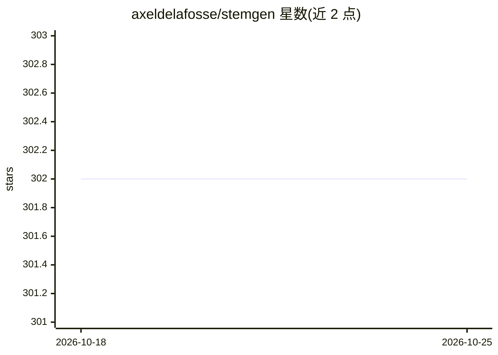

# axeldelafosse/stemgen

⭐ 302 · Python · 推送 2026-08-22 · [GitHub](https://github.com/axeldelafosse/stemgen) · [官网](https://stemgen.dev) · 个人维护

**将任意音轨分离为四轨并生成 Stem 文件的 CLI 工具**

面向 DJ 与音乐人的 Stem 文件生成器：用 bs_roformer 或 Demucs v4 模型把音轨分离为鼓、贝斯、旋律、人声四个 stem，再用 ni-stem 封装为开放多声道 Stem 文件（默认无损 ALAC，可选 AAC）。自动从母带文件抓取并回写元数据，支持批处理与从 Ableton Live 导入自有分轨，运行于 macOS/Windows/Linux。需 Python 3.9 及 ffmpeg、sox 等系统依赖；处理版权素材需自行取得授权。

## 筛选速览

| 维度 | 判定 | 备注 |
|---|---|---|
| AI 角色 | `ai-native` | 本体是模型或模型工具 |
| 许可风险 | `none` | — |
| 部署形态 | `library` | 以包/库形式分发 |
| 模型依赖 | — | README 未给出锁定关系 |
| 硬件要求 | — | 无带数字的原话,不猜 |
| 安装摩擦 | `medium` | 含编译或系统依赖之一 |
| 成熟度 | — | 结构信号不足 |

## 能力要点

- 用 bs_roformer 或 Demucs v4 做 4-stem 分离，ni-stem 封装 Stem 文件
- 默认无损 ALAC 编码，可选 qaac/Apple Audio Toolbox 的 AAC
- 自动抓取母带元数据并回写 stem 文件，支持批处理 CLI
- 支持从 Ableton Live 或按命名约定导入自制分轨

## 适用场景

- DJ 把曲库转为 Stem 文件在 Traktor 中分轨混音
- 从 Ableton Live 导出分轨打包为 Stem 格式
- 批量转换音轨（wav/aiff/flac）为 Stem 文件

## 场景标签

 · 领域:音频处理/DJ 工具

## 证据(README 行号)

> L7: Stemgen uses `bs_roformer` or `demucs` to separate the 4 stems and `ni-stem` to create the Stem file.
> L47: - bs_roformer https://github.com/axeldelafosse/BS-RoFormer or demucs v4 https://github.com/adefossez/demucs

## 星数曲线

2026-10-18 302 → 2026-10-25 302（+0）

---
*卡片 v1 · prompt 1.4 · 生成 2026-10-21 · 置信度 mid · 依据 README sha `782601e14369` · [字段定义](../../DATASET.md)*
