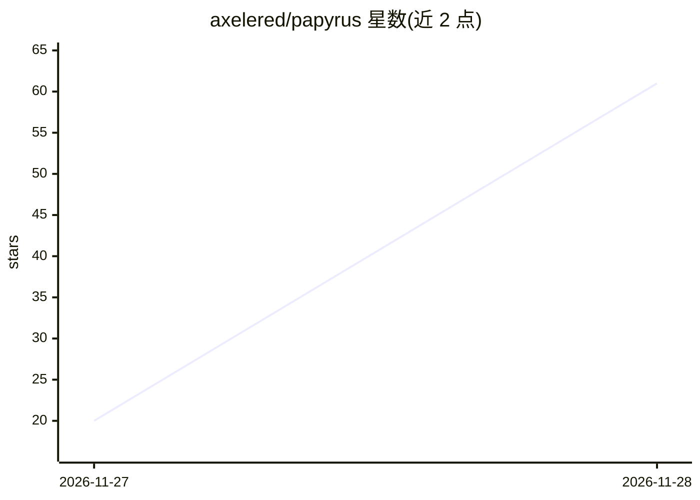

# axelered/papyrus

⭐ 61 · Python · Apache-2.0 · 推送 2026-11-27 · [GitHub](https://github.com/axelered/papyrus) · [官网](http://docs.axelered.com/papyrus) · 组织维护

**自托管文档解析 API：将文档与网页转为 LLM 可用的 Markdown/chunks**

以单个 Docker 服务形式运行的文档解析 API：接收 PDF、Office、HTML、EPUB、图片、ZIP 等输入，输出 Markdown、按嵌入模型尺寸切分的 chunks 或页面图片。文件解析在容器内 worker 进程隔离执行，URL 经 SSRF 防护，图片解码前做像素上限检查。OCR 后端可配置为自建 GPU 上的 Qwen VL 模型（vLLM/Ollama）或 Mistral OCR，auto 模式仅在文本层不可用时调用模型。另提供 Python/TypeScript SDK 与 Kubernetes Helm chart。

## 筛选速览

| 维度 | 判定 | 备注 |
|---|---|---|
| AI 角色 | `ai-ecosystem` | LLM/agent 周边工具 |
| 许可风险 | `permissive` | Apache-2.0 |
| 部署形态 | `self-host` | docker 或自建部署 |
| 模型依赖 | local-ok | 支持本地模型 |
| 硬件要求 | — | 无带数字的原话,不猜 |
| 安装摩擦 | `low` | 无编译、无系统依赖或容器化 |
| 成熟度 | — | 结构信号不足 |

## 能力要点

- 一个 Docker 服务覆盖 PDF/Office/HTML/图片等格式到 Markdown 与 chunks 的转换
- 文档在隔离 worker 中解析，配合 SSRF 防护与像素上限检查
- OCR 后端可配置：自建 GPU（vLLM/Ollama）或 Mistral，切换仅改配置
- 提供 Python/TypeScript SDK、Helm chart 与页面渲染/缩略图/截图功能

## 适用场景

- 为 RAG 管道批量把文档与网页转成分块 Markdown
- 让应用不经手不可信文件，解析隔离在独立服务中
- 扫描件与图片的 OCR，页面不出内网

## 场景标签

`文档解析` `OCR` · 领域:知识与检索

## 证据(README 行号)

> L3: **Papyrus turns documents and web pages into Markdown, chunks and images for your LLM pipeline. It runs as one Docke
> L16: 📦 **One service instead of a parser stack.** PDF, Word, PowerPoint, Excel, Outlook, HTML, EPUB, ZIP and images go i
> L20: 🔍 **OCR on your own GPUs or through Mistral.** Point Papyrus at a Qwen VL model on vLLM, Ollama or any OpenAI compa

## 星数曲线

2026-11-27 20 → 2026-11-28 61（+41）

---
*卡片 v1 · prompt 1.4 · 生成 2026-11-27 · 置信度 high · 依据 README sha `560807d8101e` · [字段定义](../../DATASET.md)*
