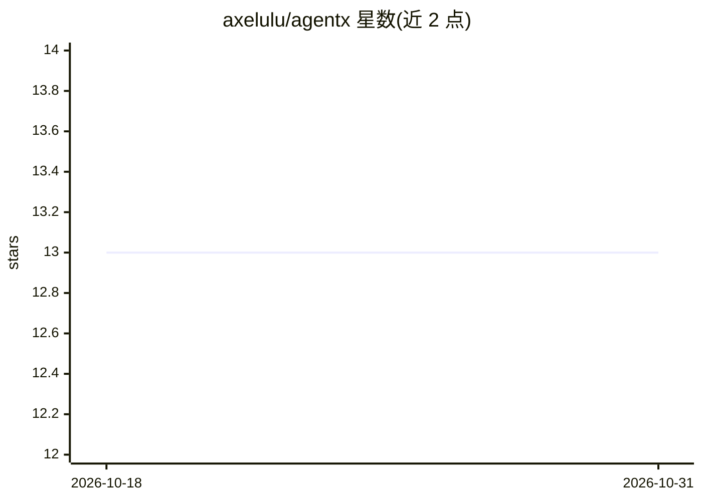

# axelulu/agentx

⭐ 13 · TypeScript · Apache-2.0 · 推送 2026-04-04 · [GitHub](https://github.com/axelulu/agentx) · 个人维护

**macOS 桌面本地优先 AI agent 助手：多模型对话并代执行任务**

基于 Tauri v2 + React 19 的开源桌面 AI agent 应用，通过回合制推理循环调用本地文件读写、Shell 执行等工具，自主完成多步任务（默认最多 50 回合）。支持 OpenAI、Anthropic、Gemini 及任意 OpenAI 兼容端点（含 Ollama/vLLM 本地服务），工具经沙箱限制在工作区内，长对话自动压缩上下文（默认 10 万 token 预算）。提供 YAML 定义的插件式工具集、MCP server 接入与知识库注入。目前仅支持 macOS，提供 dmg 安装包，也可用 Node.js 20+ 与 pnpm 从源码构建。

## 筛选速览

| 维度 | 判定 | 备注 |
|---|---|---|
| AI 角色 | `ai-native` | 本体是模型或模型工具 |
| 许可风险 | `permissive` | Apache-2.0 |
| 部署形态 | `desktop` | 安装包/桌面程序 |
| 模型依赖 | local-ok | 支持本地模型 |
| 硬件要求 | — | 无带数字的原话,不猜 |
| 安装摩擦 | `low` | 无编译、无系统依赖或容器化 |
| 成熟度 | — | 结构信号不足 |

## 能力要点

- 回合制 agent 循环，最多 50 回合，支持并行工具执行与中途插话
- 多 LLM 提供商接入，含 OpenAI 兼容自定义端点（Ollama/vLLM/LM Studio）
- YAML 定义的可扩展工具集与中间件钩子系统
- 工具结果压缩/梯度压缩/LLM 摘要的上下文管理（默认 100k token 预算）

## 适用场景

- 在 macOS 上让 AI 直接读写本地文件并执行 Shell 命令完成多步任务
- 接入自己的 API key 或本地 Ollama/vLLM 服务进行对话
- 通过 MCP server 与 YAML 工具集扩展 agent 能力

## 场景标签

`AI 助手` `聊天机器人` · 领域:对话与助手

## 证据(README 行号)

> L51: AgentX is a **local-first, general-purpose AI agent** that runs as a native desktop application. Unlike cloud-only 
> L78: AgentX uses a **turn-based agent loop** — the LLM reasons, calls tools, observes results, and continues until the t

## 星数曲线

2026-10-18 13 → 2026-10-31 13（+0）

---
*卡片 v1 · prompt 1.4 · 生成 2026-10-31 · 置信度 high · 依据 README sha `257c45b48604` · [字段定义](../../DATASET.md)*
