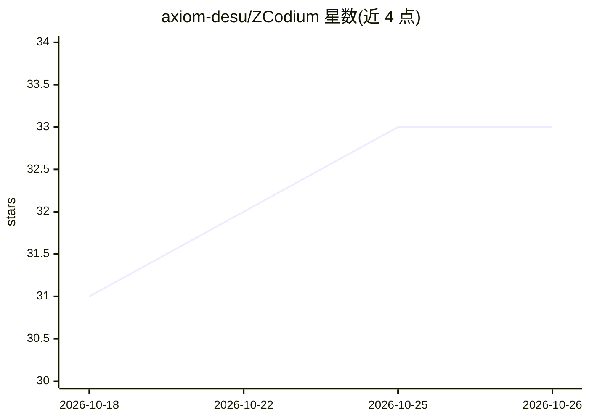

# axiom-desu/ZCodium

⭐ 33 · TypeScript · Apache-2.0 · 推送 2026-10-23 · [GitHub](https://github.com/axiom-desu/ZCodium) · [官网](https://axiom-desu.github.io/ZCodium/) · 个人维护 · 中文 README

**ZCode AI 编程工作台的社区 fork：补全官方包独有功能**

跟踪上游 zai-org/ZCode 的社区衍生仓库，含客户端、后端、共享 UI 与 Agent CLI 源码。核心工作是比对上游官方安装包与开源代码的功能差距，将仅存在于发布包的功能（内置插件、i18n 键、Computer Use 运行时、bots 桥接、手机远控等）以开源实现补齐，全部决策记录在 .agents/specs/ 下；依赖官方账号/计费体系的功能（678 键）判定不补。提供 Electron 桌面版、Web 工作台与 zcode 命令行三种形态，CI 构建多平台安装包。给希望自建构建并获得与官方包能力对等的 AI 编程工作台的开发者使用。

## 筛选速览

| 维度 | 判定 | 备注 |
|---|---|---|
| AI 角色 | `ai-native` | 本体是模型或模型工具 |
| 许可风险 | `permissive` | Apache-2.0 |
| 部署形态 | `desktop` | 安装包/桌面程序 |
| 模型依赖 | — | README 未给出锁定关系 |
| 硬件要求 | — | 无带数字的原话,不猜 |
| 安装摩擦 | `low` | 无编译、无系统依赖或容器化 |
| 成熟度 | — | 结构信号不足 |

## 能力要点

- 按官方安装包逐键核对 i18n 缺口并分类记录（有意不补 678 / 需开发 54 等）
- Computer Use 运行时复用 @trycua/cua-driver，client 缺失时 fail-closed
- AstrBot 桥接收敛为官方 BotsService 的传输 provider
- CI 构建 Linux/Windows/macOS 多平台安装包与 SHA256SUMS

## 适用场景

- 从源码构建与官方安装包能力对等的 AI 编程工作台
- 审查上游仅存在于发布包的功能并获取等价开源实现
- 在终端、浏览器或桌面使用 zcode Agent 与远程（SSH/WSL）工作区

## 场景标签

`编码 Agent` · 领域:编码与开发

## 证据(README 行号)

> L10: ZCodium Exp. 是 ZCode 的社区衍生仓库。上游 ZCode 是 AI 编程工作台，提供桌面应用、浏览器界面和终端 Agent；本仓库包含客户端、后端服务、共享 UI，以及 Agent CLI 与运行时源码。
> L96: |Desktop|Electron 桌面应用|`pnpm dev:desktop`|

## 星数曲线

2026-10-18 31 → 2026-10-26 33（+2）

---
*卡片 v1 · prompt 1.4 · 生成 2026-10-25 · 置信度 mid · 依据 README sha `b735e26687c1` · [字段定义](../../DATASET.md)*
