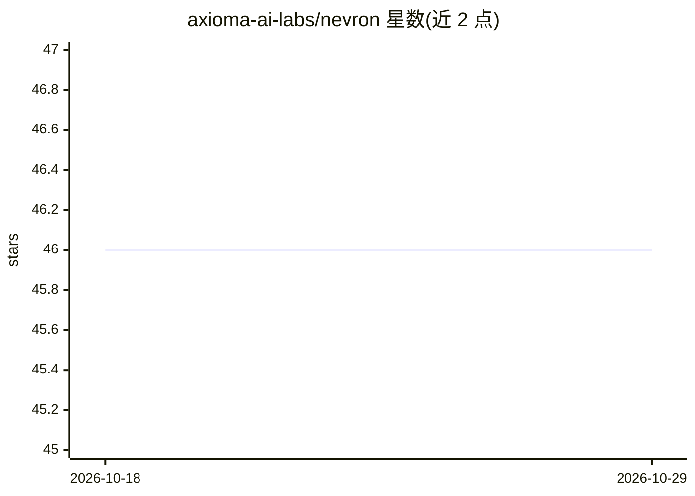

# axioma-ai-labs/nevron

⭐ 46 · Python · NOASSERTION · 推送 2026-02-18 · [GitHub](https://github.com/axioma-ai-labs/nevron) · [官网](https://axioma-ai-labs.github.io/nevron/) · 组织维护

**轻量级自主 AI Agent 框架：通过 Dashboard 构建/运行智能体**

用 Python 编写的 AI Agent 框架，采用 API（FastAPI）与 Agent 进程解耦的架构，配套 Svelte Dashboard 进行全部配置（LLM 提供商、Agent 人格与目标、集成、MCP 工具服务器），无需 .env 文件。Agent 按 Plan→Execute→Learn→Remember 循环运行，支持 OpenAI、Anthropic、xAI、DeepSeek、Qwen 等多家 LLM 提供商，并集成 Twitter、Discord、Telegram、GitHub、Tavily 等外部服务。通过 git clone 源码 + Poetry + make 命令运行，需 Python 3.11+ 与 Node.js 18+。许可证为 Nevron Public License。

## 筛选速览

| 维度 | 判定 | 备注 |
|---|---|---|
| AI 角色 | `ai-ecosystem` | LLM/agent 周边工具 |
| 许可风险 | `none` | NOASSERTION |
| 部署形态 | `library` | 以包/库形式分发 |
| 模型依赖 | locked-api |  |
| 硬件要求 | — | 无带数字的原话,不猜 |
| 安装摩擦 | `low` | 无编译、无系统依赖或容器化 |
| 成熟度 | — | 结构信号不足 |

## 能力要点

- API 与 Agent 解耦架构，Dashboard 断连时 Agent 持续运行
- 全部配置经 Dashboard UI 完成，保存至 nevron_config.json 自动加载
- 支持 OpenAI/Anthropic/xAI/DeepSeek/Qwen 等多家 LLM 提供商
- Agent 循环：Plan → Execute → Learn → Remember，含实时统计与事件流

## 适用场景

- 搭建可配置人格与目标的自主 AI Agent
- 让 Agent 接入 Twitter/Discord/Telegram 等外部服务与 MCP 工具服务器
- 通过 Web Dashboard 监控与管理 Agent 运行状态

## 场景标签

`Agent 框架` · 领域:Agent 开发

## 证据(README 行号)

> L1: # Nevron - Lightweight AI Agent Framework
> L107: ## Supported LLM Providers

## 星数曲线

2026-10-18 46 → 2026-10-29 46（+0）

---
*卡片 v1 · prompt 1.4 · 生成 2026-10-25 · 置信度 mid · 依据 README sha `ac59d773890c` · [字段定义](../../DATASET.md)*
