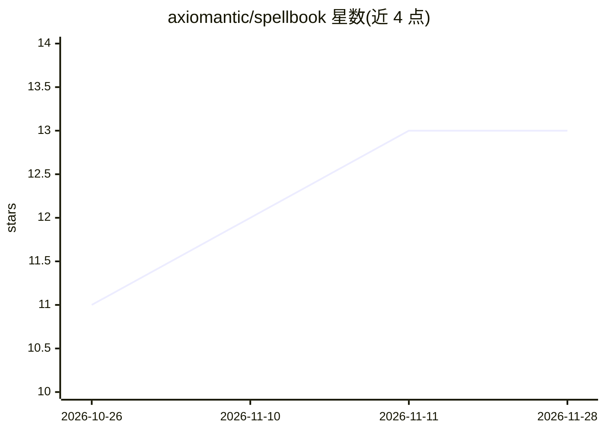

# axiomantic/spellbook

⭐ 13 · Python · MIT · 推送 2026-11-25 · [GitHub](https://github.com/axiomantic/spellbook) · [官网](https://axiomantic.github.io/spellbook/latest/) · 个人维护

**为 AI 编码助手跨平台提供技能、命令与共享 MCP 服务器的增强层**

Spellbook 以安装脚本形式部署，向 Claude Code、OpenCode、Codex、Gemini CLI 等多个 AI 编码 harness 注入 skills、slash commands、hooks、profiles 与共享 MCP 服务器（记忆、focus stints、会话恢复），同一项目的上下文可跨 harness 复用。内置 62 个技能与 108 个命令，核心 develop 技能编排研究、设计、规划、实现、验证、收尾的完整流程，通过子代理并行分发与阶段间质量门禁约束执行。安装依赖 Python 3.10+ 与 git。

## 筛选速览

| 维度 | 判定 | 备注 |
|---|---|---|
| AI 角色 | `ai-ecosystem` | LLM/agent 周边工具 |
| 许可风险 | `permissive` | MIT |
| 部署形态 | `library` | 以包/库形式分发 |
| 模型依赖 | — | README 未给出锁定关系 |
| 硬件要求 | — | 无带数字的原话,不猜 |
| 安装摩擦 | `low` | 无编译、无系统依赖或容器化 |
| 成熟度 | — | 结构信号不足 |

## 能力要点

- 跨 harness 共享的集中式 MCP 服务器（记忆、会话恢复、focus stints）
- 62 个技能 / 108 个命令，含编排全生命周期的 develop 技能
- 阶段间强制质量门禁与命名失败模式的机械化对策
- 子代理编排与三种并行策略（顺序/并发/worktree）

## 适用场景

- 在多个 AI 编码助手之间保持同一项目的工作流与记忆
- 以自主或交互模式让助手完成特性开发的完整流程
- 为 LLM 编码过程加入事实核查与防幻觉检查点

## 场景标签

`提示工程` `编码 Agent` `Agent 框架` · 领域:Agent 开发

## 证据(README 行号)

> L5:  A harness-augmentation layer for AI coding assistants. Skills, commands, hooks, and a shared MCP server that runs a
> L49: Spellbook is a harness-augmentation layer for AI coding assistants. The *harness* is the runtime that hosts the age
> L54: - **Shared centralized MCP server.** Memories, focus stints, and session-resume state live in one place, so context

## 星数曲线

2026-10-26 11 → 2026-11-28 13（+2）

---
*卡片 v1 · prompt 1.4 · 生成 2026-11-18 · 置信度 mid · 依据 README sha `6351cecb2327` · [字段定义](../../DATASET.md)*
