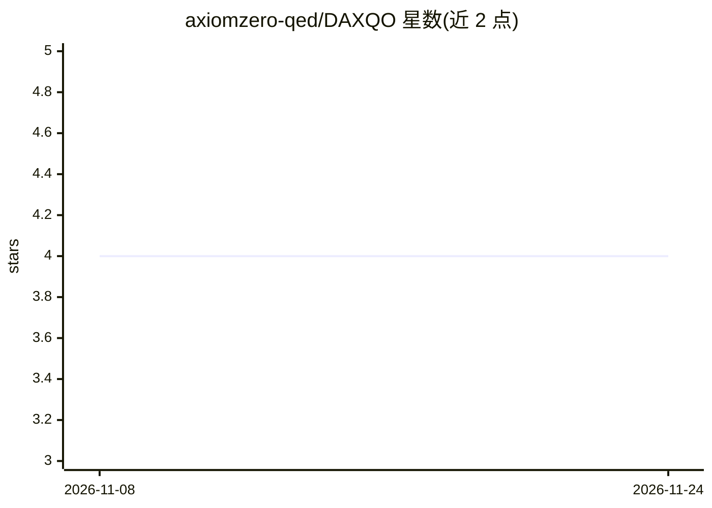

# axiomzero-qed/DAXQO

⭐ 4 · Python · MIT · 推送 2026-10-26 · [GitHub](https://github.com/axiomzero-qed/DAXQO) · 个人维护 · 中文 README

**手机上的本地 Linux Agent 工作台：任务在手机内执行**

DAXQO 是面向 Android 手机的 Agent 工作台：Android App 提供持续对话与成果界面，V1.0 将 Android 应用、PRoot、Ubuntu 用户态、Python 3.12、Codex 0.163.0、Motor、Trajectory Collector、邮件依赖与本机语音模型打进单个 ARM64 APK，首次启动在本机准备运行环境，无需 Termux 或电脑。模型通过用户自行配置的 API key 接入；本地语音识别在手机上运行，云模型、邮件和短信需网络或通信服务。V0.x 历史路径依赖手机内已有 Linux 用户环境。项目采用 MIT 许可证。

## 筛选速览

| 维度 | 判定 | 备注 |
|---|---|---|
| AI 角色 | `ai-native` | 本体是模型或模型工具 |
| 许可风险 | `permissive` | MIT |
| 部署形态 | `None` |  |
| 模型依赖 | locked-api |  |
| 硬件要求 | — | 无带数字的原话,不猜 |
| 安装摩擦 | `medium` | 含编译或系统依赖之一 |
| 成熟度 | — | 结构信号不足 |

## 能力要点

- V1.0 单 APK 打包本地 Linux 用户态与语音模型，完全断网可完成首次初始化
- 支持定时任务、持久化会话/任务/文件、GUI 成果交付与任务停止/恢复
- V0.7 提供本机流式中文语音草稿与默认关闭的可信号码短信任务控制
- 可信邮箱支持 Gmail/QQ/网易，邮件审批与息屏续跑流程在真机验证

## 适用场景

- 在无电脑环境下用手机创建并执行模型任务
- 配置定时任务并支持息屏锁屏续跑
- 通过可信邮箱提交任务并接收结果回信

## 场景标签

`语音识别` `AI 助手` · 领域:对话与助手

## 证据(README 行号)

> L37: DAXQO 是面向手机的 Agent 工作台：Android 提供持续对话与成果界面，V1.0 的工具在 App 自带的 Linux 用户态环境执行，模型通过用户配置的 API 接入。项目采用 MIT 许可证；仓库地址为 axio
> L15: V1.0 面向 ARM64 STEPX Neo，把 Android 应用、PRoot、Ubuntu 用户态、Python 3.12、Codex 0.163.0、Motor、Trajectory Collector、邮件依赖和本机语

## 星数曲线

2026-11-08 4 → 2026-11-24 4（+0）

---
*卡片 v1 · prompt 1.4 · 生成 2026-11-21 · 置信度 high · 依据 README sha `726ef76b8ff1` · [字段定义](../../DATASET.md)*
