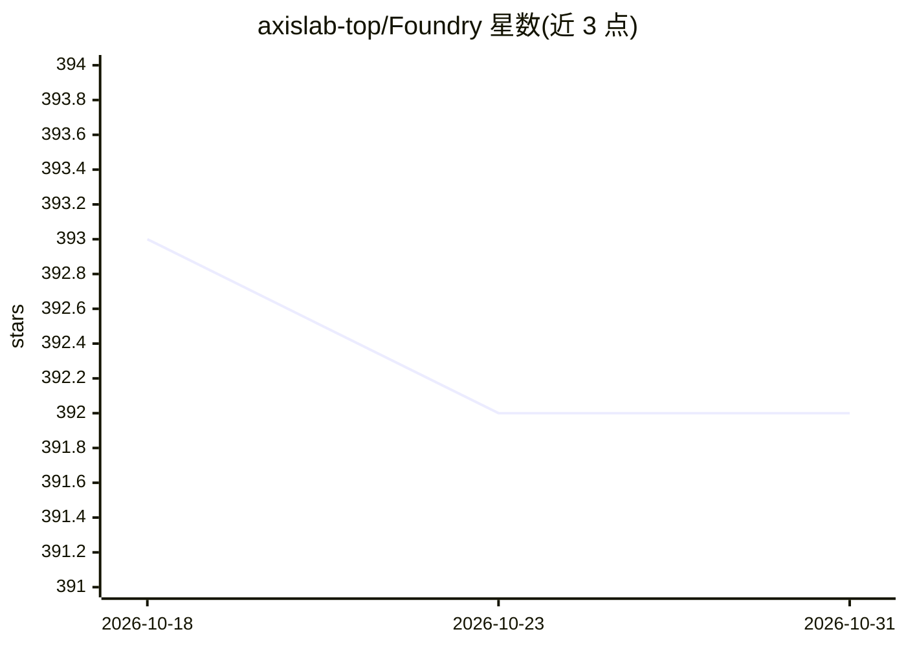

# axislab-top/Foundry

⭐ 392 · TypeScript · GPL-3.0 · 推送 2026-06-30 · [GitHub](https://github.com/axislab-top/Foundry) · [官网](https://www.axislab.top) · 组织维护 · 中文 README

**开源 AI 数字公司平台：多 Agent 自主协作完成任务**

基于 NestJS + React 的多 Agent 平台，模拟公司组织结构：CEO Agent 做战略拆解，部门主管 Agent 编排子任务，员工 Agent 执行任务；支持群聊协作、human-in-the-loop 审批、三层记忆（公司/部门/Agent，pgvector RAG 检索）、CEO Agent 约 30 分钟周期的自主心跳循环、成本追踪与预算控制、模型路由与 LLM Key 池管理。通过 pnpm 一键脚本部署，基础设施（PostgreSQL/Redis/RabbitMQ/Consul/Nginx）以 Docker Compose 运行；需在管理面板配置 LLM API Key。GPL-3.0 许可，面向不写代码直接使用平台的用户。

## 筛选速览

| 维度 | 判定 | 备注 |
|---|---|---|
| AI 角色 | `ai-native` | 本体是模型或模型工具 |
| 许可风险 | `viral` | GPL-3.0 |
| 部署形态 | `self-host` | docker 或自建部署 |
| 模型依赖 | — | README 未给出锁定关系 |
| 硬件要求 | — | 无带数字的原话,不猜 |
| 安装摩擦 | `low` | 无编译、无系统依赖或容器化 |
| 成熟度 | — | 结构信号不足 |

## 能力要点

- Board→CEO→部门主管→员工 Agent 层级自动生成
- CEO Agent 约 30 分钟自主心跳循环，无需人工提示
- 三层记忆 + pgvector RAG 检索与记忆整合
- token 成本实时追踪、公司级预算与智能模型路由

## 适用场景

- 输入战略目标后让 AI 公司自主拆解并执行任务
- 在群聊中 @CEO 下达任务并审批关键决策
- 多公司/多租户场景下管理 Agent 团队与预算

## 场景标签

`多智能体` · 领域:Agent 开发

## 证据(README 行号)

> L27: Foundry is an **open-source AI-powered digital company platform**. Unlike agent frameworks where you have to orches
> L31: **Typical scenario**: You say "Analyze competitors and create a report" in a group chat. The CEO Agent automaticall
> L352: Foundry is an **AI digital company platform** — you register, create a company, and the AI runs automatically. No 

## 星数曲线

2026-10-18 393 → 2026-10-31 392（-1）

---
*卡片 v1 · prompt 1.4 · 生成 2026-10-21 · 置信度 high · 依据 README sha `617421e30266` · [字段定义](../../DATASET.md)*
