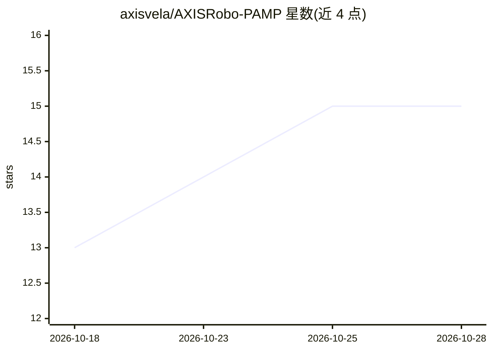

# axisvela/AXISRobo-PAMP

⭐ 15 · Python · NOASSERTION · 推送 2026-10-26 · [GitHub](https://github.com/axisvela/AXISRobo-PAMP) · 个人维护 · 中文 README

**面向企业架构师的 EA 治理平台：评审、组合与决策管理**

模块化企业架构管理平台，覆盖 EA 评审工作流、应用组合管理（BCM/CMDB）、ADD 架构决策与设计、PACT 关注点目录、视角/制品映射与报告。实现 AVDM 决策链：问卷→关注点→视角→制品，含单信号与组合激活规则、风险评分。技术栈为 Next.js 16 + FastAPI (Python 3.12) + PostgreSQL 14+（pamp 模式 100 表），95+ 端点均经 RBAC 门控并记录审计日志。AI 功能为评审中的 AI 架构检查（接入 LLM API）与 AI 项目自评估（AT0-AT8×L0-L4 矩阵、49 项清单）。本地需 Node.js 22、Python 3.12、PostgreSQL 14+，源码运行。

## 筛选速览

| 维度 | 判定 | 备注 |
|---|---|---|
| AI 角色 | `ai-enhanced` | 去掉 AI 部分产品仍成立 |
| 许可风险 | `none` | NOASSERTION |
| 部署形态 | `self-host` | docker 或自建部署 |
| 模型依赖 | — | README 未给出锁定关系 |
| 硬件要求 | — | 无带数字的原话,不猜 |
| 安装摩擦 | `low` | 无编译、无系统依赖或容器化 |
| 成熟度 | — | 结构信号不足 |

## 动量与使用信号

- 安装:github 包 `release-assets` 月下载无数据

## 能力要点

- AVDM 决策链：问卷→关注点→视角→制品，支持单信号与组合激活规则
- AI 项目自评估：AT0-AT8 采用层级 × L0-L4 治理成熟度矩阵，11 节 49 项清单
- 95+ API 端点全部 RBAC 门控，追加式审计日志
- 可插拔架构：认证（本地 JWT/Keycloak/Dev）、存储（S3/数据库）均经接口抽象

## 适用场景

- 组织内运行架构评审流程并跟踪会议、行动项与风险
- 用问卷驱动架构视角选择与制品推荐
- 对 AI 项目做治理成熟度自评估
- 维护业务能力映射与应用组合

## 场景标签

 · 领域:企业架构管理/IT 治理

## 证据(README 行号)

> L124: |**EA Review**|Architecture review workflow, meetings, actions, AI architecture checks, AVDM questionnaire|
> L139:                                          → LLM API (AI architecture review)

## 星数曲线

2026-10-18 13 → 2026-10-28 15（+2）

---
*卡片 v1 · prompt 1.4 · 生成 2026-10-18 · 置信度 mid · 依据 README sha `6493c1c12b29` · [字段定义](../../DATASET.md)*
