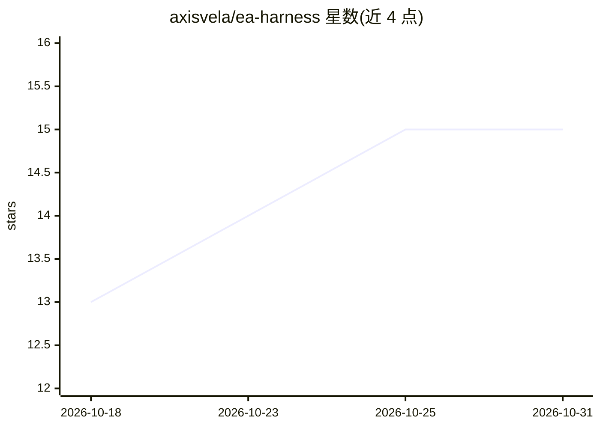

# axisvela/ea-harness

⭐ 15 · Python · MIT · 推送 2026-10-26 · [GitHub](https://github.com/axisvela/ea-harness) · [官网](https://github.com/axisrobo/ea-harness) · 组织维护 · 中文 README

**企业架构设计与校验技能包：让 AI 编码助手执行架构工作流**

面向 Claude Code、OpenCode、Codex、GitHub Copilot、Cursor 的企业架构技能包与 CLI：包含 14 个 arch-* 技能/代理（需求访谈、需求合并、架构设计、图表生成、六维校验、安全审计、评审门禁、报告生成），由 arch-workflow 门禁强制阶段顺序，产物经哈希校验，BLOCK 决策可中止流水线。一个模型可编译为 draw.io 可编辑源与 D2 渲染图（matplotlib 兜底），支持多项目工作区隔离，通过 git clone、install 脚本或 pip 安装，Claude Code 可经插件市场安装。

## 筛选速览

| 维度 | 判定 | 备注 |
|---|---|---|
| AI 角色 | `ai-ecosystem` | LLM/agent 周边工具 |
| 许可风险 | `permissive` | MIT |
| 部署形态 | `library` | 以包/库形式分发 |
| 模型依赖 | — | README 未给出锁定关系 |
| 硬件要求 | — | 无带数字的原话,不猜 |
| 安装摩擦 | `low` | 无编译、无系统依赖或容器化 |
| 成熟度 | — | 结构信号不足 |

## 能力要点

- 14 个 arch-* 技能/代理覆盖需求→设计→图表→校验→门禁全流程
- arch-workflow 门禁强制阶段顺序，产物哈希校验、篡改即失败
- 一个架构模型编译为 draw.io（可编辑）与 D2（渲染）双格式
- 多项目工作区隔离，CLI 提供 doctor 自检与确定性规则检查（arch-check/trace-check）

## 适用场景

- 在 AI 编码助手中按门禁流程产出需求与架构设计文档
- 把架构 YAML 生成 draw.io/D2 图并做六维打分校验
- CI 中用 arch-enforce 门禁对架构产物做 PASS/WARN/BLOCK 判定

## 场景标签

`AI 写作` `代码审查` · 领域:编码与开发

## 证据(README 行号)

> L5: Enterprise architecture design and validation skill pack for **Claude Code**, **OpenCode**,
> L65: |Agent / Skill|Claude Code|OpenCode|Role|
> L18: > **Not yet another README-only repo.** `archharness` ships a real CLI

## 星数曲线

2026-10-18 13 → 2026-10-31 15（+2）

---
*卡片 v1 · prompt 1.4 · 生成 2026-10-30 · 置信度 high · 依据 README sha `7f48b7e32ced` · [字段定义](../../DATASET.md)*
