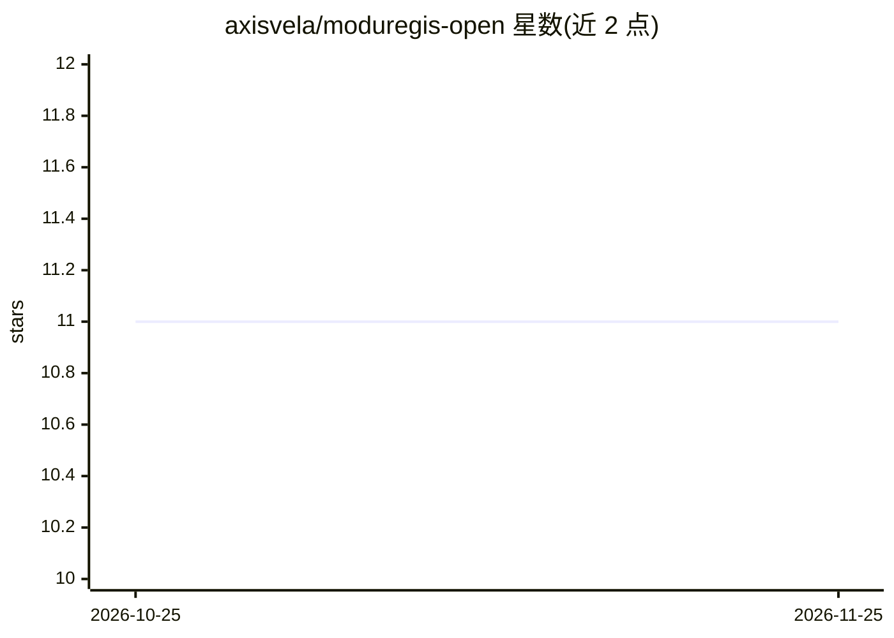

# axisvela/moduregis-open

⭐ 11 · TypeScript · Apache-2.0 · 推送 2026-11-08 · [GitHub](https://github.com/axisvela/moduregis-open) · 组织维护

**企业能力治理控制平面：发布、发现、授权、调用与审计**

MODUREGIS Open 是 AxisVela 企业能力平台的公开 OSS 仓库，提供能力契约（版本化 JSON Schema 与 fixtures）、目录 API 契约（含意图匹配与候选解释）、CapabilityPlan 计划契约、治理适配器契约、Go SDK 与 TypeScript/React Console。核心实现在独立仓库中尚待开源决策，本仓库包含文档、契约、SDK 与二进制发布链接。运行需 PostgreSQL 16，OSS 版提供基础多租户与策略绑定，企业版另售 SAML/SCIM、跨区复制等能力。

## 筛选速览

| 维度 | 判定 | 备注 |
|---|---|---|
| AI 角色 | `ai-ecosystem` | LLM/agent 周边工具 |
| 许可风险 | `permissive` | Apache-2.0 |
| 部署形态 | `desktop` | 安装包/桌面程序 |
| 模型依赖 | — | README 未给出锁定关系 |
| 硬件要求 | — | 无带数字的原话,不猜 |
| 安装摩擦 | `low` | 无编译、无系统依赖或容器化 |
| 成熟度 | `idea` | |

## 能力要点

- 版本化 JSON Schema 契约与正/负 fixtures 作为一致性参照
- 目录 API 契约支持能力发现与解析，含意图匹配与候选解释
- 提供 Go SDK 与 TypeScript/React 参考 Console
- 二进制发布，要求 PostgreSQL 16 作为运行时依赖

## 适用场景

- 为平台运营者、发布者与审计者提供能力目录与发布工作流
- 通过版本化适配器契约接入执行、规划、工作流等子系统
- 以受治理方式发布、校验、发现并调用企业能力

## 场景标签

 · 领域:API/能力治理平台

## 证据(README 行号)

> L3: **MODUREGIS** is the AxisVela Enterprise Capability Platform — the control plane for publishing, discovering, govern
> L14: - **Catalog API Contracts** — REST API surface for capability discovery and resolution, including intent matching a
> L29: Moduregis owns Capability identity, version, lifecycle, owner, policy binding, and the cross-system audit index. It

## 星数曲线

2026-10-25 11 → 2026-11-25 11（+0）

---
*卡片 v1 · prompt 1.4 · 生成 2026-11-18 · 置信度 mid · 依据 README sha `a31414b76cc3` · [字段定义](../../DATASET.md)*
