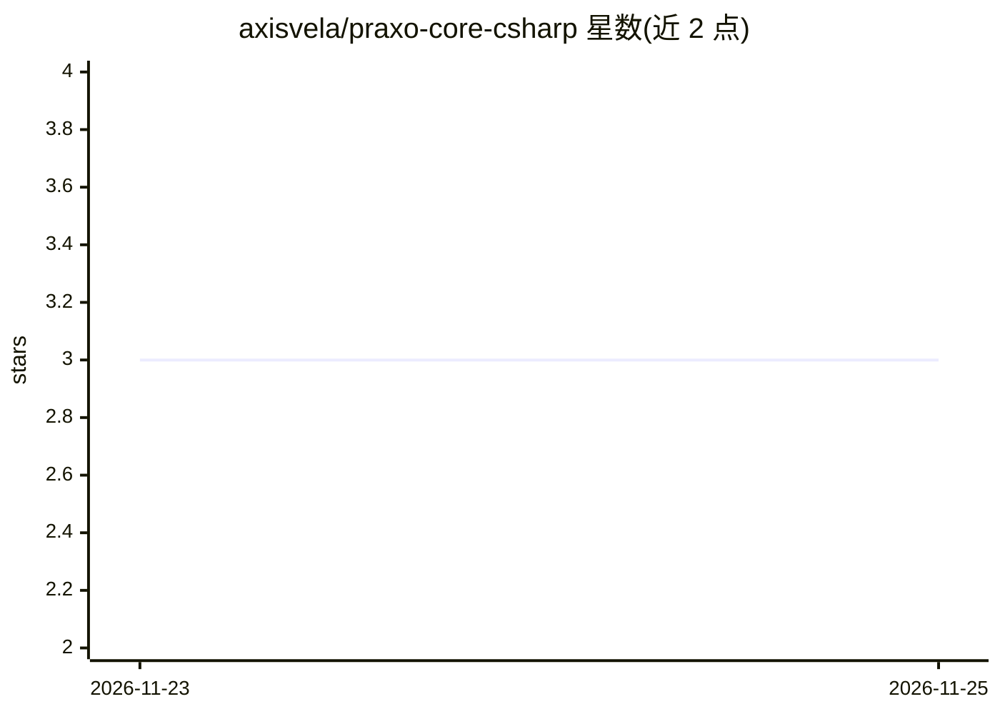

# axisvela/praxo-core-csharp

⭐ 3 · C# · MIT · 推送 2026-11-23 · [GitHub](https://github.com/axisvela/praxo-core-csharp) · [官网](https://axisvela.github.io/praxo-core/languages/csharp/) · 组织维护

**.NET 开发者的可嵌入 AI agent 框架（策略/工具/检查点）**

PRAXO-CORE 的 C#/.NET 实现，以 NuGet 包 Praxo.Core 发布：提供 agent 循环、工具注册与调度、策略钩子、类型化事件、内存、检查点、上下文预算、中间件、JSON Schema 校验与插件清单解析，进程内运行、无需托管服务。原生接入 OpenAI 兼容端点、Anthropic、Gemini 模型及 MCP 客户端，带子代理委托、检索器、OpenTelemetry 事件槽，并附 14 个可运行示例与一致性测试。仓库为镜像，权威源在 monorepo。

## 筛选速览

| 维度 | 判定 | 备注 |
|---|---|---|
| AI 角色 | `ai-ecosystem` | LLM/agent 周边工具 |
| 许可风险 | `permissive` | MIT |
| 部署形态 | `None` |  |
| 模型依赖 | — | README 未给出锁定关系 |
| 硬件要求 | — | 无带数字的原话,不猜 |
| 安装摩擦 | `medium` | 含编译或系统依赖之一 |
| 成熟度 | — | 结构信号不足 |

## 能力要点

- agent 循环 + 工具调度 + 策略钩子 + 检查点的框架内核
- OpenAI 兼容/Anthropic/Gemini 模型与 MCP 客户端原生支持（SSE 流式）
- 子代理委托、文档检索器、结构化输出与人工审批示例
- 进程内嵌入运行，不依赖托管服务

## 适用场景

- 在 .NET 应用中嵌入带策略治理的 agent 运行时
- 构建需要检查点恢复的多轮对话 agent
- 接入 MCP 工具生态并做失败重试/模型回退

## 场景标签

`Agent 框架` `Agent 记忆` `多智能体` · 领域:Agent 开发

## 证据(README 行号)

> L3: PRAXO-CORE is an embeddable, MIT-licensed agent framework. This package is its native .NET Core: an agent loop with 
> L22: - OpenAI-compatible model: native

## 星数曲线

2026-11-23 3 → 2026-11-25 3（+0）

---
*卡片 v1 · prompt 1.4 · 生成 2026-11-23 · 置信度 high · 依据 README sha `56a7da384540` · [字段定义](../../DATASET.md)*
