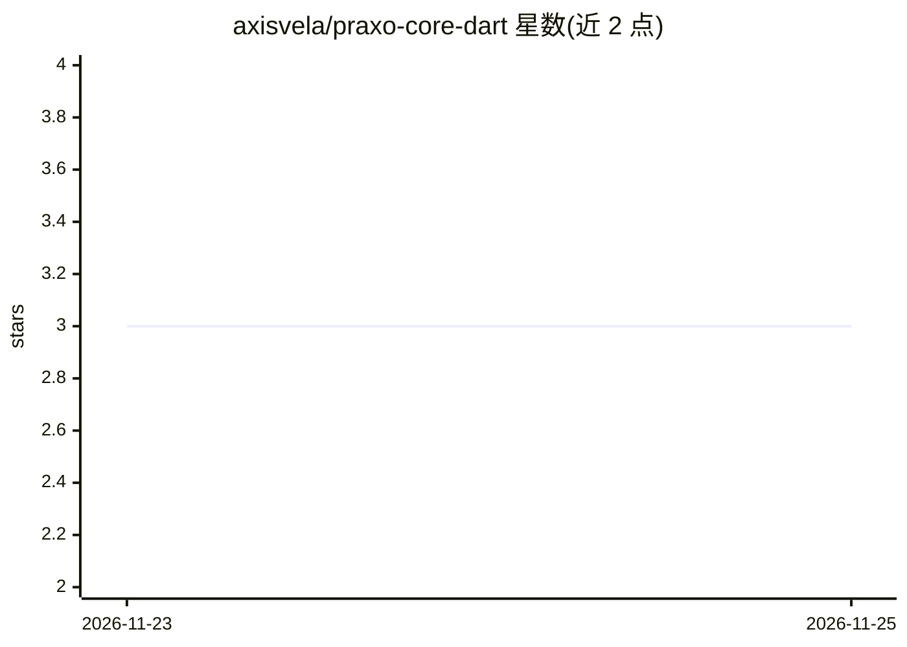

# axisvela/praxo-core-dart

⭐ 3 · Dart · MIT · 推送 2026-11-23 · [GitHub](https://github.com/axisvela/praxo-core-dart) · [官网](https://axisvela.github.io/praxo-core/languages/dart/) · 组织维护

**Dart 嵌入式 AI agent 框架：工具调度、策略钩子与检查点**

PRAXO-CORE 的 Dart 实现，是一个可嵌入进程内运行的 agent 框架库：提供 agent 循环、工具注册与分发、策略钩子、类型化事件、记忆与检查点、上下文预算、中间件、JSON Schema 校验及插件清单解析。内置 OpenAI 兼容、Anthropic、Gemini 三种模型适配与 MCP 客户端、子代理同步委托、检索器接口，并通过 OTel 与 Harmovela sink 输出事件。通过 pub.dev 分发，MIT 许可，不要求托管服务；仓库为规范 monorepo 的发现镜像。

## 筛选速览

| 维度 | 判定 | 备注 |
|---|---|---|
| AI 角色 | `ai-ecosystem` | LLM/agent 周边工具 |
| 许可风险 | `permissive` | MIT |
| 部署形态 | `None` |  |
| 模型依赖 | — | README 未给出锁定关系 |
| 硬件要求 | — | 无带数字的原话,不猜 |
| 安装摩擦 | `low` | 无编译、无系统依赖或容器化 |
| 成熟度 | — | 结构信号不足 |

## 能力要点

- 原生支持 OpenAI 兼容、Anthropic、Gemini 三类模型及 SSE 流式重组
- 内置 MCP 客户端（stdio 与 Streamable HTTP 传输）
- 策略钩子、检查点、上下文预算与中间件等运行时机制
- 提供 15 个可运行示例（HITL、身份策略、重试、结构化输出等）

## 适用场景

- 在 Dart 应用中嵌入带策略治理的 agent 循环
- 需要人工审批写操作或身份/租户绑定的 agent 场景
- 通过 MCP 客户端接入工具服务
- 用检查点保存与恢复跨轮次的会话状态

## 场景标签

`Agent 框架` · 领域:Agent 开发

## 证据(README 行号)

> L3: PRAXO-CORE is an embeddable, MIT-licensed agent framework. This package is its native Dart Core: an agent loop with 
> L45: |OpenAI-compatible model|native|`OpenAiCompatibleModel` with sync and async transport paths; `generateStream` reass
> L48: |MCP client|native|`McpClient`; stdio, plus `McpStreamableHttpTransport` for Streamable HTTP 2025-03-26|

## 星数曲线

2026-11-23 3 → 2026-11-25 3（+0）

---
*卡片 v1 · prompt 1.4 · 生成 2026-11-23 · 置信度 high · 依据 README sha `ebab7da59b89` · [字段定义](../../DATASET.md)*
