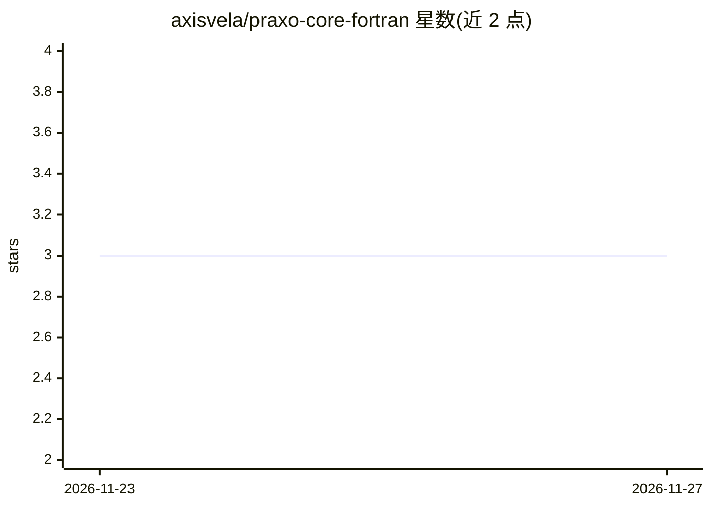

# axisvela/praxo-core-fortran

⭐ 3 · Fortran · MIT · 推送 2026-11-26 · [GitHub](https://github.com/axisvela/praxo-core-fortran) · [官网](https://axisvela.github.io/praxo-core/languages/fortran/) · 组织维护

**面向 Fortran 开发者的可嵌入 AI agent 框架核心库**

PRAXO-CORE 的 Fortran 2008 原生实现，提供进程内 agent 循环，包含工具注册、策略、中间件、事件、检查点与人审（human-in-the-loop）决策，不桥接其他运行时。模型接入通过传输接缝完成：调用方提供 HTTP 传输，实现负责重组 SSE 流中的内容、工具调用、用量与结束原因。仓库为镜像仓库，源码未发布到包注册表，需按 monorepo 内的子 README 从源码构建，并提供 14 个可运行示例覆盖检查点、策略、MCP、重试、结构化输出等。

## 筛选速览

| 维度 | 判定 | 备注 |
|---|---|---|
| AI 角色 | `ai-ecosystem` | LLM/agent 周边工具 |
| 许可风险 | `permissive` | MIT |
| 部署形态 | `None` |  |
| 模型依赖 | — | README 未给出锁定关系 |
| 硬件要求 | — | 无带数字的原话,不猜 |
| 安装摩擦 | `low` | 无编译、无系统依赖或容器化 |
| 成熟度 | — | 结构信号不足 |

## 能力要点

- 进程内 agent 循环：工具、策略、中间件、事件、检查点、人审决策
- OpenAI 兼容 / Anthropic / Gemini 三种模型接缝，含 SSE 流重组
- MCP 客户端与 OpenTelemetry/Harmovela 事件 sink 接缝
- 14 个可运行示例与共享契约向量的一致性测试

## 适用场景

- 在 Fortran 项目中嵌入带策略与检查点的 agent 循环
- 对接自建的 OpenAI 兼容端点并注册领域工具
- 实现需要人工审批的写操作工具流程
- 用 MCP 客户端以进程内传输调用工具服务

## 场景标签

`Agent 框架` · 领域:Agent 开发

## 证据(README 行号)

> L3: PRAXO-CORE is an embeddable, MIT-licensed agent framework. This package is its native Fortran 2008 Core: an in-proce
> L25: - MCP client: native (transport seam)

## 星数曲线

2026-11-23 3 → 2026-11-27 3（+0）

---
*卡片 v1 · prompt 1.4 · 生成 2026-11-23 · 置信度 high · 依据 README sha `aba26872e8f6` · [字段定义](../../DATASET.md)*
