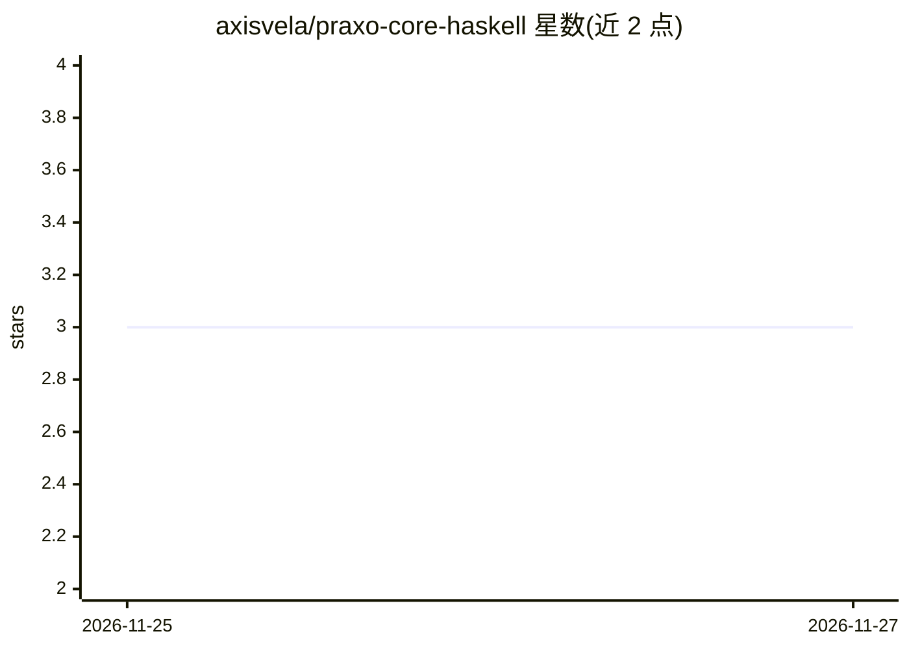

# axisvela/praxo-core-haskell

⭐ 3 · Haskell · MIT · 推送 2026-11-26 · [GitHub](https://github.com/axisvela/praxo-core-haskell) · [官网](https://axisvela.github.io/praxo-core/languages/haskell/) · 组织维护

**Haskell 可嵌入 AI Agent 框架，带策略与检查点**

PRAXO-CORE 的原生 Haskell 实现，MIT 许可，以 Hackage 包 praxo-core 发布，安装方式为 cabal install。提供回调式 agent 循环，包含工具调用、策略钩子、类型化事件、记忆、检查点、上下文预算、中间件、JSON Schema 校验与插件清单解析。模型接入（OpenAI 兼容、Anthropic、Gemini）与 MCP 客户端均为 transport seam 形式，由调用方提供传输层，不捆绑 HTTP 客户端。README 声明本包不是托管模型、工作流引擎或安全控制器。本仓库是规范源码的发现镜像，权威源在 monorepo。

## 筛选速览

| 维度 | 判定 | 备注 |
|---|---|---|
| AI 角色 | `ai-ecosystem` | LLM/agent 周边工具 |
| 许可风险 | `permissive` | MIT |
| 部署形态 | `None` |  |
| 模型依赖 | — | README 未给出锁定关系 |
| 硬件要求 | — | 无带数字的原话,不猜 |
| 安装摩擦 | `low` | 无编译、无系统依赖或容器化 |
| 成熟度 | — | 结构信号不足 |

## 能力要点

- 回调式 agent 循环：工具、策略钩子、类型化事件、记忆与检查点
- OpenAI 兼容/Anthropic/Gemini 模型与 MCP 客户端，调用方提供 transport
- JSON Schema 校验、上下文预算、中间件与插件清单解析
- 附 15 个可运行示例，覆盖 HITL、委派、降级重试与流式输出

## 适用场景

- 在 Haskell 应用中嵌入带策略控制与检查点的 agent 循环
- 接入 OpenAI 兼容端点并注册带 JSON Schema 的工具调用
- 实现需要人工审批（HITL）的写操作 agent
- 通过子代理委派与事件汇聚构建多代理治理流程

## 场景标签

`Agent 框架` · 领域:Agent 开发

## 证据(README 行号)

> L3: PRAXO-CORE is an embeddable, MIT-licensed AI agent framework. This package is its native Haskell Core. It implements
> L11: |Install|`cabal install praxo-core`|

## 星数曲线

2026-11-25 3 → 2026-11-27 3（+0）

---
*卡片 v1 · prompt 1.4 · 生成 2026-11-24 · 置信度 high · 依据 README sha `64d4e9644a12` · [字段定义](../../DATASET.md)*
