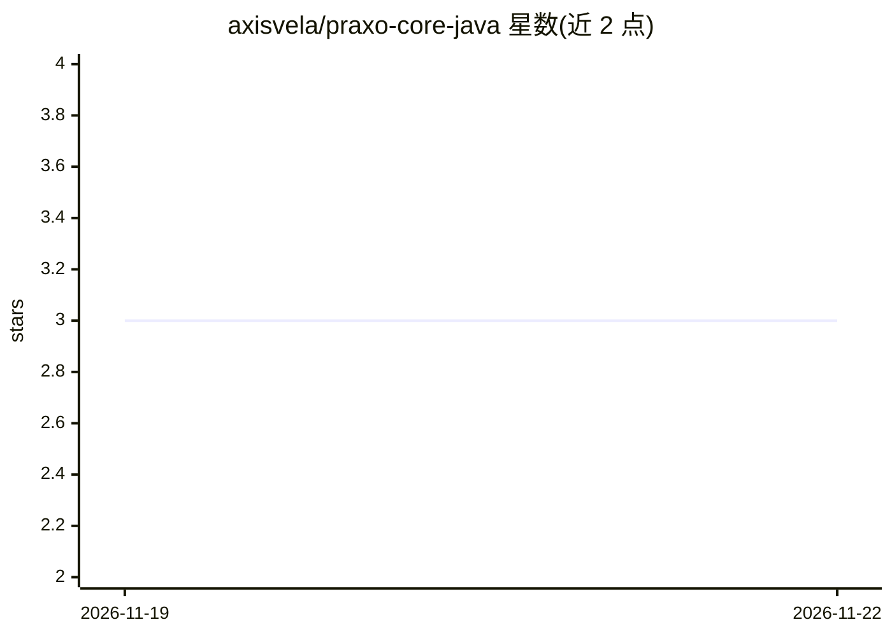

# axisvela/praxo-core-java

⭐ 3 · Java · MIT · 推送 2026-11-21 · [GitHub](https://github.com/axisvela/praxo-core-java) · [官网](https://axisvela.github.io/praxo-core/languages/java/) · 组织维护

**可嵌入 Java 应用的 AI Agent 框架实现**

PRAXO-CORE 契约的 Java 实现，以 Maven 包（com.axisvela:praxo-core）发布，供应用嵌入使用。内置 OpenAI 兼容、Anthropic、Gemini 三类模型适配器（含 SSE 流式），支持 MCP 客户端、子 Agent 委派、检索器、OpenTelemetry/Harmovela 事件汇、策略授权、工具调用、检查点保存与恢复等能力，并附 16 个可运行示例。本仓库为发现镜像，规范契约与 Go 参考实现位于 monorepo；README 声明其非托管模型、工作流引擎或安全控制器。

## 筛选速览

| 维度 | 判定 | 备注 |
|---|---|---|
| AI 角色 | `ai-ecosystem` | LLM/agent 周边工具 |
| 许可风险 | `permissive` | MIT |
| 部署形态 | `None` |  |
| 模型依赖 | — | README 未给出锁定关系 |
| 硬件要求 | — | 无带数字的原话,不猜 |
| 安装摩擦 | `low` | 无编译、无系统依赖或容器化 |
| 成熟度 | — | 结构信号不足 |

## 能力要点

- OpenAI 兼容 / Anthropic / Gemini 模型适配器均为 native，支持 SSE 流式
- MCP 客户端支持 stdio 与 Streamable HTTP 传输
- 子 Agent 委派、策略授权、检查点保存恢复、重试与降级示例
- 通过 Maven Central 发布，提供 16 个可运行示例

## 适用场景

- 在 Java/JVM 服务中嵌入带策略与工具调用的 Agent 运行时
- 构建多 Agent 父子委派与会话检查点应用
- 为 Agent 接入 OpenTelemetry 观测与事件汇

## 场景标签

`Agent 框架` `多智能体` · 领域:Agent 开发

## 证据(README 行号)

> L3: Java implementation of the PRAXO-CORE contract. The normative contract is `spec/`; Go remains the reference implemen
> L22: - OpenAI-compatible model: native
> L58: |Subagent delegation|native|`agent.delegation.SubagentManager`|

## 星数曲线

2026-11-19 3 → 2026-11-22 3（+0）

---
*卡片 v1 · prompt 1.4 · 生成 2026-11-22 · 置信度 high · 依据 README sha `a23335e41be1` · [字段定义](../../DATASET.md)*
