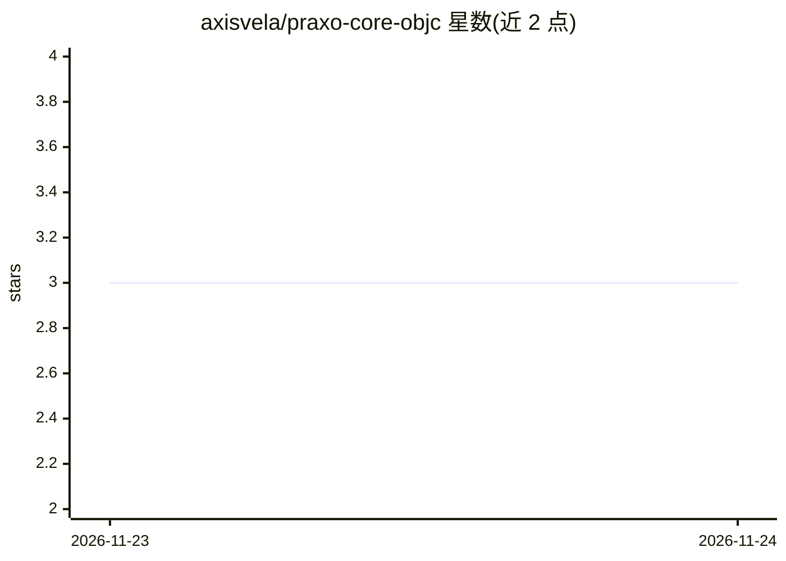

# axisvela/praxo-core-objc

⭐ 3 · Objective-C · MIT · 推送 2026-11-23 · [GitHub](https://github.com/axisvela/praxo-core-objc) · [官网](https://axisvela.github.io/praxo-core/languages/objc/) · 组织维护

**Objective-C 可嵌入 AI agent 框架，提供策略/工具/事件/检查点**

PRAXO-CORE 的 Objective-C 实现源码镜像仓库（源标签 objc/v0.7.0）。作为嵌入式 agent 框架提供原生 agent 循环、上下文压缩、记忆存储、路径策略、检查点允许列表、工具选择与调用解析、结构化输出校验、调用次数限制、人在环中断及可选 PII 脱敏等能力。原生支持 OpenAI 兼容、Anthropic、Gemini 三类模型接入，含 MCP 客户端、OpenTelemetry/Harmovela 事件 sink、子 agent 委派与文档检索器。仅提供源码，需按 language/objc/README.md 的说明构建；通过共享 spec 向量与测试脚本验证。

## 筛选速览

| 维度 | 判定 | 备注 |
|---|---|---|
| AI 角色 | `ai-ecosystem` | LLM/agent 周边工具 |
| 许可风险 | `permissive` | MIT |
| 部署形态 | `None` |  |
| 模型依赖 | — | README 未给出锁定关系 |
| 硬件要求 | — | 无带数字的原话,不猜 |
| 安装摩擦 | `low` | 无编译、无系统依赖或容器化 |
| 成熟度 | — | 结构信号不足 |

## 能力要点

- 原生支持 OpenAI 兼容/Anthropic/Gemini 模型接入与 SSE 流式重组
- 内置 MCP 客户端（stdio 与 Streamable HTTP 传输）
- 提供策略引擎、检查点允许列表、人在环中断与 PII 脱敏
- 附带 17 个可运行示例（委派/HITL/回退/流式/结构化输出等）

## 适用场景

- 在 Objective-C/iOS 应用中嵌入受策略约束的 agent 运行时
- 构建需要工具调用、人在环审批与检查点恢复的 agent 流程
- 通过 MCP 客户端接入外部工具服务
- 需要子 agent 委派与事件外发（OTel/Harmovela）的 agent 架构

## 场景标签

`Agent 框架` `多智能体` · 领域:Agent 开发

## 证据(README 行号)

> L3: Objective-C is a native Core implementation with source tag `objc/v0.7.0`. It passes all eleven shared vector groups
> L22: - OpenAI-compatible model: native

## 星数曲线

2026-11-23 3 → 2026-11-24 3（+0）

---
*卡片 v1 · prompt 1.4 · 生成 2026-11-23 · 置信度 high · 依据 README sha `9d4f386b2362` · [字段定义](../../DATASET.md)*
