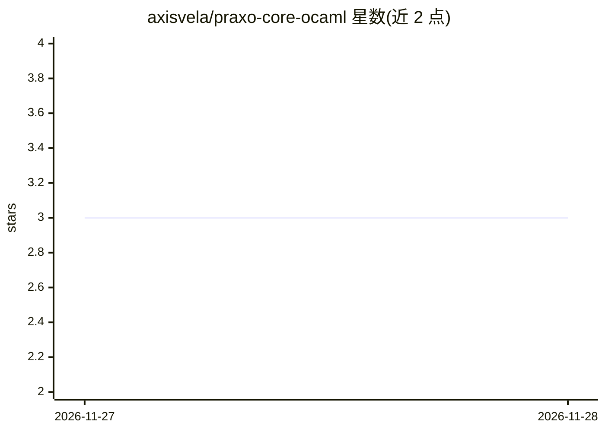

# axisvela/praxo-core-ocaml

⭐ 3 · OCaml · MIT · 推送 2026-11-26 · [GitHub](https://github.com/axisvela/praxo-core-ocaml) · [官网](https://axisvela.github.io/praxo-core/languages/ocaml/) · 组织维护

**为 OCaml 开发者提供可嵌入的 AI agent 框架核心库**

以 opam/Dune 源码包形式发布的 OCaml agent 框架核心：内置 agent 循环（步数/令牌预算、PII 脱敏、HITL 中断审批）、工具调用解析与 schema/manifest 校验、会话记忆与检查点、上下文压缩、事件汇与中间件，并提供 OpenAI 兼容、Anthropic、Gemini 三种请求适配器及 MCP/OpenTelemetry 接缝。调用方自行提供 HTTP 传输与凭证，库不捆绑网络客户端。文档明列未验证平台、JSON 大小上限及非沙箱等限制。

## 筛选速览

| 维度 | 判定 | 备注 |
|---|---|---|
| AI 角色 | `ai-ecosystem` | LLM/agent 周边工具 |
| 许可风险 | `permissive` | MIT |
| 部署形态 | `None` |  |
| 模型依赖 | — | README 未给出锁定关系 |
| 硬件要求 | — | 无带数字的原话,不猜 |
| 安装摩擦 | `low` | 无编译、无系统依赖或容器化 |
| 成熟度 | — | 结构信号不足 |

## 能力要点

- agent 循环含步数/令牌预算、策略钩子、HITL 中断与事件
- OpenAI 兼容、Anthropic、Gemini 适配器，支持 SSE 流式
- MCP 与 OpenTelemetry 传输接缝、检索与子代理委托接缝
- JSON-Lines 进程插件主机，含令牌认证与健康握手

## 适用场景

- 在 OCaml 应用中嵌入带策略与检查点的 agent 循环
- 接入 OpenAI/Anthropic/Gemini 接口构建流式工具调用代理
- 需要人工审批（approve/edit/reject）环节的自动化流程
- 通过 OpenTelemetry 汇出 agent 事件为 OTLP spans

## 场景标签

`Agent 框架` · 领域:Agent 开发

## 证据(README 行号)

> L3: PRAXO-CORE is an embeddable, MIT-licensed AI agent framework. This standalone
> L47: - Agent loop with step and token budgets, call limits, PII redaction,
> L50: - OpenAI-compatible, Anthropic, and Gemini request/response adapters, including

## 星数曲线

2026-11-27 3 → 2026-11-28 3（+0）

---
*卡片 v1 · prompt 1.4 · 生成 2026-11-27 · 置信度 high · 依据 README sha `fff08baecc1a` · [字段定义](../../DATASET.md)*
