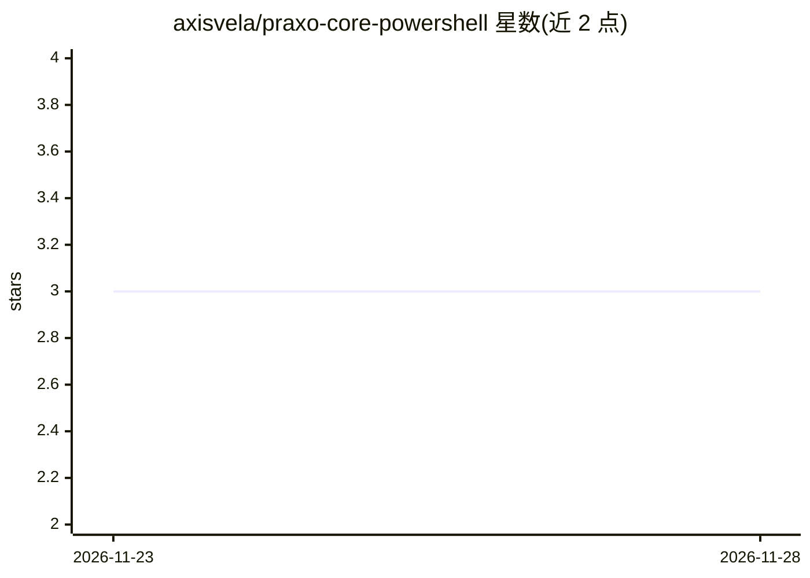

# axisvela/praxo-core-powershell

⭐ 3 · PowerShell · MIT · 推送 2026-11-27 · [GitHub](https://github.com/axisvela/praxo-core-powershell) · [官网](https://axisvela.github.io/praxo-core/languages/powershell/) · 组织维护

**给 PowerShell 自动化场景提供可嵌入的 AI agent 框架**

PRAXO-CORE 的 PowerShell 实现：以共享 C# 运行时为底座的包装层，为现有 PowerShell 自动化提供模型/工具循环、显式策略与工具作用域、事件、内存、检查点和人工审批（HITL）。能力清单标注 inherited（复用 C# Core）或 native（如 MCP 客户端包装、同步子 agent 委派）。通过 PowerShell Gallery 以模块 praxo-core-ps 发布，本仓库为规范源码的发现镜像，monorepo 为权威源。README 明确声明其不托管模型、非工作流引擎或安全控制器。

## 筛选速览

| 维度 | 判定 | 备注 |
|---|---|---|
| AI 角色 | `ai-ecosystem` | LLM/agent 周边工具 |
| 许可风险 | `permissive` | MIT |
| 部署形态 | `None` |  |
| 模型依赖 | — | README 未给出锁定关系 |
| 硬件要求 | — | 无带数字的原话,不猜 |
| 安装摩擦 | `medium` | 含编译或系统依赖之一 |
| 成熟度 | — | 结构信号不足 |

## 能力要点

- 通过 Install-Module praxo-core-ps 从 PowerShell Gallery 安装
- MCP 客户端包装 C# 实现，支持 stdio/Streamable HTTP 传输
- 带人工审批工具、检查点恢复、子 agent 委派与 OpenTelemetry 事件汇
- 13 个可运行示例覆盖策略、重试、结构化输出、流式等场景

## 适用场景

- 在现有 PowerShell 自动化脚本中加入模型与工具调用循环
- 需要显式策略绑定与人工审批的 agent 工具写入操作
- 用 MCP 工具扩展 PowerShell agent 的能力边界

## 场景标签

`Agent 框架` · 领域:Agent 开发

## 证据(README 行号)

> L3: PRAXO-CORE is an embeddable, MIT-licensed agent framework. This package is its PowerShell Core: a shared-runtime wra
> L22: - OpenAI-compatible model: inherited

## 星数曲线

2026-11-23 3 → 2026-11-28 3（+0）

---
*卡片 v1 · prompt 1.4 · 生成 2026-11-23 · 置信度 high · 依据 README sha `e098195b0134` · [字段定义](../../DATASET.md)*
