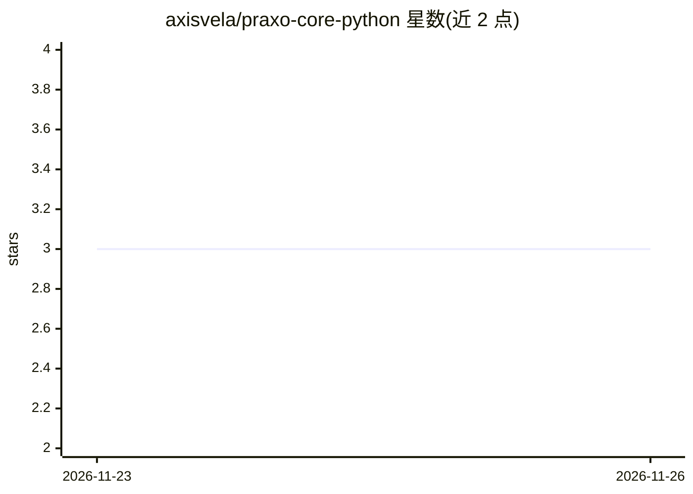

# axisvela/praxo-core-python

⭐ 3 · Python · MIT · 推送 2026-11-25 · [GitHub](https://github.com/axisvela/praxo-core-python) · [官网](https://axisvela.github.io/praxo-core/languages/python/) · 组织维护

**面向开发者的可嵌入 Python AI agent 框架，提供运行时**

PRAXO-CORE 的 Python 实现，零运行时依赖的 AI agent 构建框架，提供 agent 运行时而非模型或托管服务，模型、工具、存储与沙箱由应用方掌控。核心机制包括异步的模型/工具/事件/会话抽象、策略钩子（审批、路径检查、PII 脱敏、调用限额）、上下文预算、检查点、中间件与模型回退，并内置 OpenAI 兼容、Anthropic、Gemini 适配器与 MCP 客户端。需 Python 3.11+，通过 PyPI 安装，本仓库为镜像，规范源在 monorepo。

## 筛选速览

| 维度 | 判定 | 备注 |
|---|---|---|
| AI 角色 | `ai-ecosystem` | LLM/agent 周边工具 |
| 许可风险 | `permissive` | MIT |
| 部署形态 | `library` | 以包/库形式分发 |
| 模型依赖 | — | README 未给出锁定关系 |
| 硬件要求 | — | 无带数字的原话,不猜 |
| 安装摩擦 | `low` | 无编译、无系统依赖或容器化 |
| 成熟度 | — | 结构信号不足 |

## 能力要点

- 零运行时依赖，Python 3.11+，MIT 许可
- 策略钩子：审批、路径检查、PII 脱敏、调用限额
- 检查点、上下文预算、中间件与模型回退
- 内置 OpenAI 兼容/Anthropic/Gemini 适配器与 MCP 客户端

## 适用场景

- 在自有应用中嵌入工具调用型 agent 运行时
- 对 agent 的工具调用做审批与 PII 脱敏等策略控制
- 接入 MCP 服务器并向 agent 注册工具
- 构建需要检查点恢复与多模型回退的 agent 服务

## 场景标签

`Agent 框架` `Agent 记忆` · 领域:Agent 开发

## 证据(README 行号)

> L3: PRAXO-CORE is a dependency-free Python framework for building tool-using AI agents. It provides the agent runtime, n
> L25: - Streaming, cancellation, and OpenAI-compatible, Anthropic, and Gemini adapters.

## 星数曲线

2026-11-23 3 → 2026-11-26 3（+0）

---
*卡片 v1 · prompt 1.4 · 生成 2026-11-23 · 置信度 high · 依据 README sha `e0a931e88227` · [字段定义](../../DATASET.md)*
