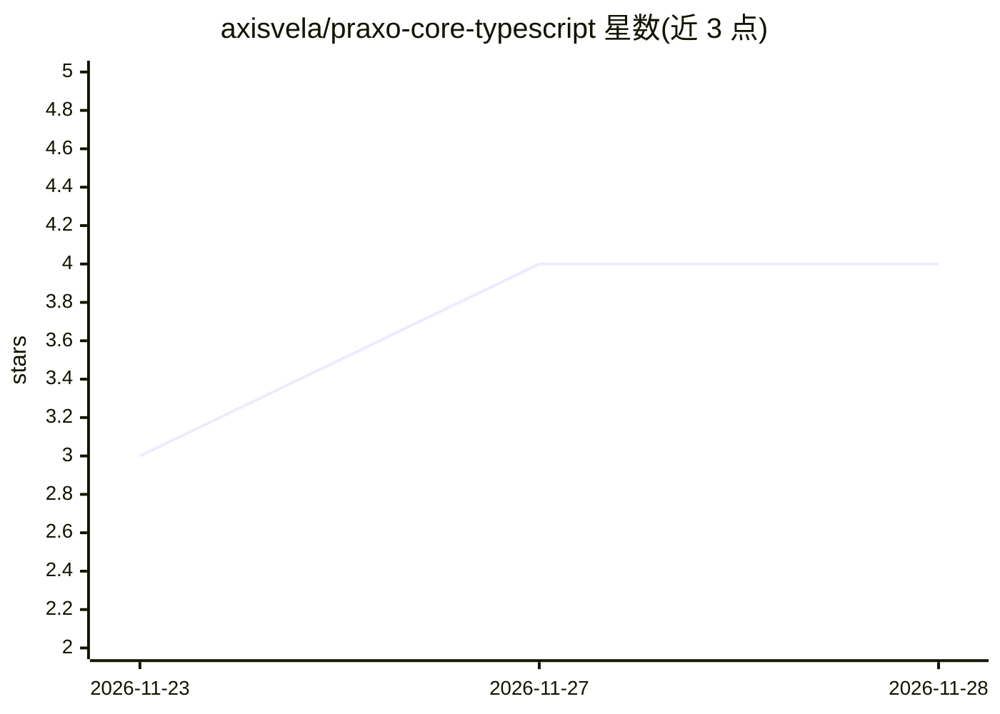

# axisvela/praxo-core-typescript

⭐ 4 · JavaScript · MIT · 推送 2026-11-27 · [GitHub](https://github.com/axisvela/praxo-core-typescript) · [官网](https://axisvela.github.io/praxo-core/languages/typescript/) · 组织维护

**面向开发者的无依赖 TypeScript AI agent 框架**

PRAXO-CORE 的 TypeScript 实现，是一个零运行时依赖、用于构建工具调用型 AI agent 的框架。提供 agent 运行时而非模型或托管服务，由应用自行掌控模型、工具、存储与沙箱。机制上包含类型化的模型/工具/事件/会话抽象、策略钩子（审批、路径检查、PII 脱敏、调用限额）、上下文预算、检查点、中间件、模型回退、流式与取消，以及 OpenAI 兼容/Anthropic/Gemini/MCP 适配器。要求 Node.js 20 以上，经 npm 安装，本仓库为规范单体的发现镜像。

## 筛选速览

| 维度 | 判定 | 备注 |
|---|---|---|
| AI 角色 | `ai-ecosystem` | LLM/agent 周边工具 |
| 许可风险 | `permissive` | MIT |
| 部署形态 | `library` | 以包/库形式分发 |
| 模型依赖 | — | README 未给出锁定关系 |
| 硬件要求 | — | 无带数字的原话,不猜 |
| 安装摩擦 | `low` | 无编译、无系统依赖或容器化 |
| 成熟度 | — | 结构信号不足 |

## 能力要点

- 零运行时依赖的 TypeScript agent 运行时，要求 Node.js 20+
- 策略机制：审批钩子、路径检查、PII 脱敏、调用限额
- OpenAI 兼容、Anthropic、Gemini 原生适配器与 SSE 流式
- MCP 客户端（stdio 与 Streamable HTTP）及子 agent 委派、检查点

## 适用场景

- 在自有应用中嵌入带策略管控的工具调用 agent
- 需要人工审批（HITL）与身份绑定的企业 agent 服务
- 跨模型故障回退与重试的多模型 agent 场景
- 通过 MCP 接入外部工具服务

## 场景标签

`Agent 框架` · 领域:Agent 开发

## 证据(README 行号)

> L3: PRAXO-CORE is a dependency-free TypeScript framework for building tool-using AI agents. It provides the agent runtim
> L25: - Streaming, `AbortSignal` cancellation, and OpenAI-compatible, Anthropic, and Gemini adapters.

## 星数曲线

2026-11-23 3 → 2026-11-28 4（+1）

---
*卡片 v1 · prompt 1.4 · 生成 2026-11-23 · 置信度 high · 依据 README sha `d26d2ba22ffc` · [字段定义](../../DATASET.md)*
