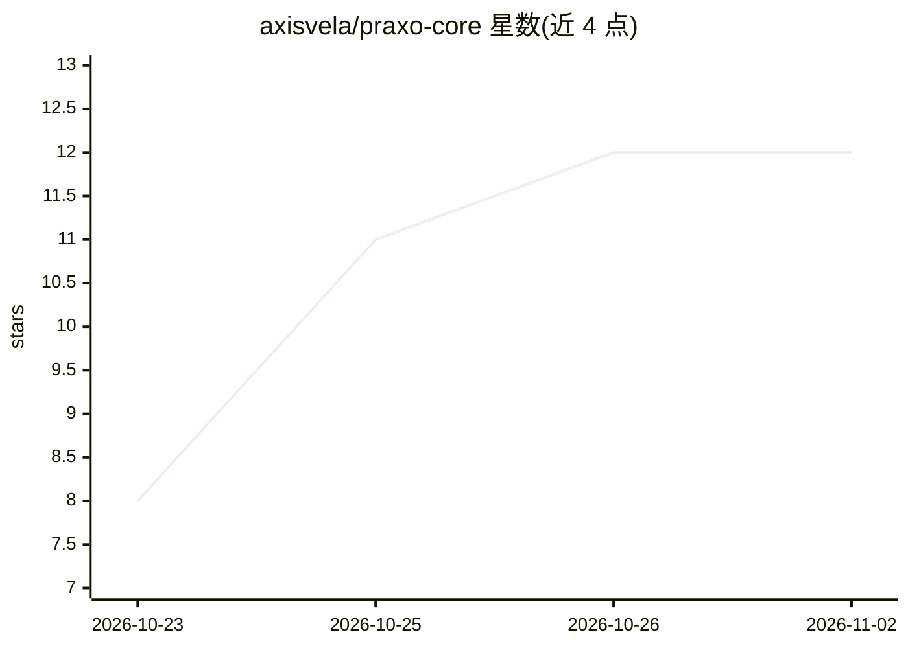

# axisvela/praxo-core

⭐ 12 · Go · MIT · 推送 2026-11-01 · [GitHub](https://github.com/axisvela/praxo-core) · [官网](https://axisvela.github.io/praxo-core/) · 组织维护 · 中文 README

**可嵌入的 MIT 协议 Agent 框架：治理式 agent 循环与策略控制**

以 Go 为参考实现的嵌入式 agent 框架，提供治理式 agent 循环、模型/工具/记忆/事件/检索/沙箱等中立接口、策略钩子与工具授权、检查点恢复、结构化事件与可选 OpenTelemetry 集成。面向在自己的产品中构建受治理 agent 的开发者，可自带模型提供方与适配器，AxisVela 产品非必需。明确声明它不是托管 agent 服务、向量数据库、模型提供方或聊天 UI；Go 之外的多语言实现处于不同成熟状态，需按各自说明判断。

## 筛选速览

| 维度 | 判定 | 备注 |
|---|---|---|
| AI 角色 | `ai-ecosystem` | LLM/agent 周边工具 |
| 许可风险 | `permissive` | MIT |
| 部署形态 | `None` |  |
| 模型依赖 | local-ok | 支持本地模型 |
| 硬件要求 | — | 无带数字的原话,不猜 |
| 安装摩擦 | `low` | 无编译、无系统依赖或容器化 |
| 成熟度 | — | 结构信号不足 |

## 能力要点

- 策略钩子、工具授权与 HITL 决策的显式治理机制
- 检查点与会话契约支持运行恢复
- 模型/记忆/工具/检索/沙箱的中立接口，通过适配器接入自有提供方
- Go 为参考实现，另有 Python/TypeScript/Java 等多语言 Core 源码

## 适用场景

- 在自有产品内嵌入带策略控制的 agent 执行循环
- 本地 Ollama 或 OpenAI 兼容端点跑通工具调用与流式示例
- 需要审批边界、沙箱与事件追踪的受治理 agent 场景

## 场景标签

`Agent 框架` · 领域:Agent 开发

## 证据(README 行号)

> L10: **An embeddable MIT-licensed agent framework with explicit policy controls,
> L13: Build governed agents inside your own product without rebuilding the agent
> L58: It is a framework, not a hosted agent service, vector database, model provider,

## 星数曲线

2026-10-23 8 → 2026-11-02 12（+4）

---
*卡片 v1 · prompt 1.4 · 生成 2026-11-01 · 置信度 high · 依据 README sha `d11e921deaf9` · [字段定义](../../DATASET.md)*
