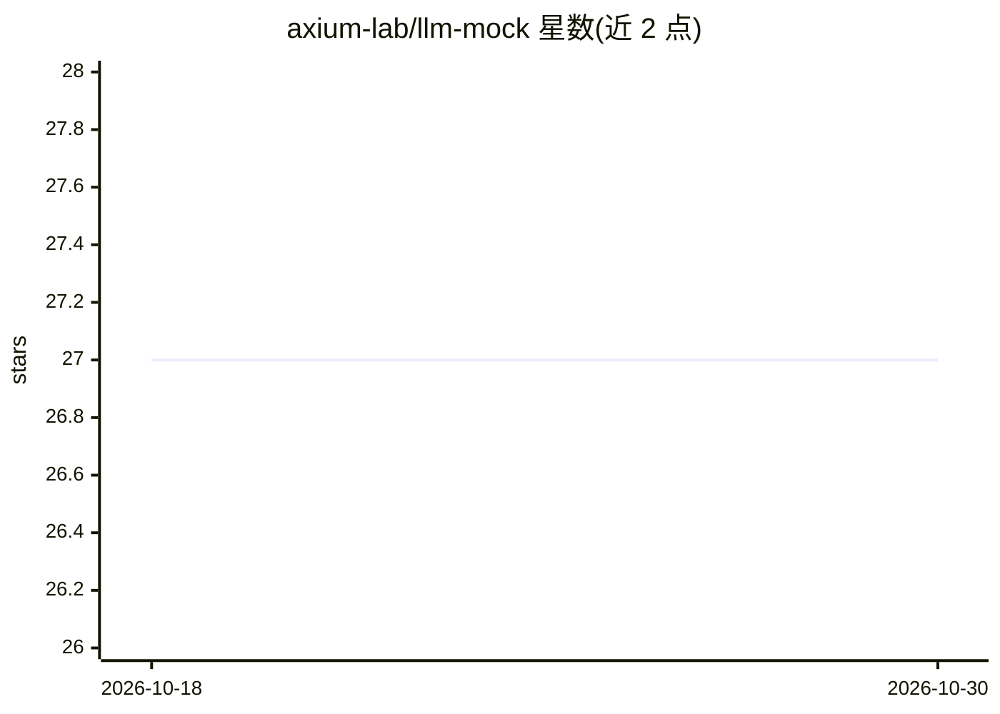

# axium-lab/llm-mock

⭐ 27 · TypeScript · MIT · 推送 2026-08-10 · [GitHub](https://github.com/axium-lab/llm-mock) · 组织维护

**自托管多厂商 LLM API mock 服务器，用于集成测试**

本地运行的 LLM 提供商 API mock 服务器：以相同端点、响应形状、错误封装与 SSE 流式格式复刻 OpenAI、Anthropic、Gemini、Gemini Enterprise 与 Azure 的契约，返回确定性回复（id 为内容哈希、时间戳由其派生），无状态。通过请求头（如 x-llm-mock-response）控制回复内容，覆盖鉴权成败、内容过滤等失败路径，CI 中用官方 SDK 验证兼容性。面向需要在 CI 中测试 LLM 集成而不消耗真实 API 调用或暴露密钥的开发者；可用 Bun 运行源码或 Docker 镜像部署。

## 筛选速览

| 维度 | 判定 | 备注 |
|---|---|---|
| AI 角色 | `ai-ecosystem` | LLM/agent 周边工具 |
| 许可风险 | `permissive` | MIT |
| 部署形态 | `self-host` | docker 或自建部署 |
| 模型依赖 | locked-api |  |
| 硬件要求 | — | 无带数字的原话,不猜 |
| 安装摩擦 | `low` | 无编译、无系统依赖或容器化 |
| 成熟度 | — | 结构信号不足 |

## 能力要点

- 复刻 5 个提供商（OpenAI/Anthropic/Gemini/Gemini Enterprise/Azure）的 API 契约与错误封装
- 确定性无状态回复：同一请求返回相同字节，适配快照测试
- 请求头控制回复内容（文本、Base64、tool calls、内容过滤判定）
- 提供免费托管实例 api.llm-mock.dev 与 GHCR 多架构 Docker 镜像

## 适用场景

- 在 CI 中测试 LLM 应用而不产生真实 API 费用
- 验证应用的错误处理路径（无效密钥、未知模型、验证错误）
- 开源项目提供一个无需密钥即可对接的演示端点

## 场景标签

 · 领域:LLM 基础设施/测试工具

## 证据(README 行号)

> L12: **A drop-in mock of LLM provider APIs for integration tests and open source projects. Change the `baseURL`, keep yo
> L14: Testing an app built on an LLM SDK usually means paying for real API calls in CI, or leaking a key into a place it 

## 星数曲线

2026-10-18 27 → 2026-10-30 27（+0）

---
*卡片 v1 · prompt 1.4 · 生成 2026-10-26 · 置信度 high · 依据 README sha `47622d5f180d` · [字段定义](../../DATASET.md)*
