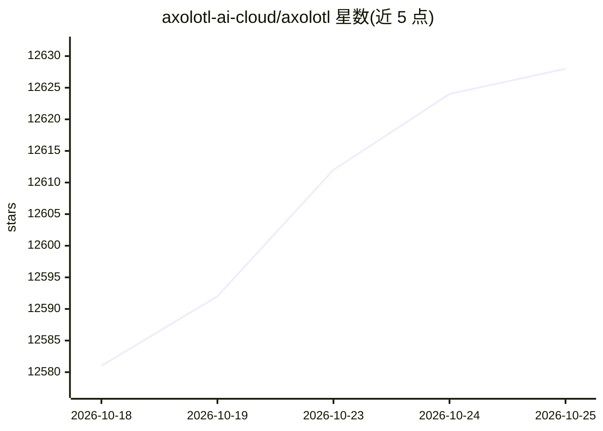

# axolotl-ai-cloud/axolotl

⭐ 12,628 · Python · Apache-2.0 · 推送 2026-10-24 · [GitHub](https://github.com/axolotl-ai-cloud/axolotl) · [官网](https://docs.axolotl.ai) · 组织维护

**开源 LLM 后训练/微调框架，面向开发者**

Axolotl 是免费开源的大语言模型后训练与微调工具，支持 GPT-OSS、LLaMA、Mistral 等模型及多模态（VLM/音频）微调。训练方法覆盖全参微调、LoRA/QLoRA、QAT（int8/int4/FP8/NVFP4）、偏好调优（DPO/KTO/ORPO）、RL（GRPO）与奖励建模。通过单一 YAML 配置贯穿数据预处理、训练、量化与推理流程；支持多 GPU（FSDP2/DeepSpeed）与多节点训练。以 pip 包与 Docker 镜像分发，需 NVIDIA（Ampere+）或 AMD GPU，Python≥3.12、PyTorch≥2.13。默认开启可退出的遥测。Apache 2.0 许可。

## 筛选速览

| 维度 | 判定 | 备注 |
|---|---|---|
| AI 角色 | `ai-ecosystem` | LLM/agent 周边工具 |
| 许可风险 | `permissive` | Apache-2.0 |
| 部署形态 | `self-host` | docker 或自建部署 |
| 模型依赖 | — | README 未给出锁定关系 |
| 硬件要求 | — | 无带数字的原话,不猜 |
| 安装摩擦 | `low` | 无编译、无系统依赖或容器化 |
| 成熟度 | — | 结构信号不足 |

## 能力要点

- 全参/LoRA/QLoRA/QAT（含 NVFP4、FP8 MoE LoRA）等多训练方法
- 单一 YAML 配置贯穿预处理、训练、评估、量化与推理
- 多 GPU（FSDP2/DeepSpeed）与多节点（Torchrun/Ray）训练
- 支持 GGUF 导出并可选量化以配合 llama.cpp 与 Ollama 部署

## 适用场景

- 在本地或云端 GPU 上对开源 LLM 做 LoRA/全参微调
- 微调视觉语言模型与音频模型
- 用 DPO/GRPO 等方法做偏好对齐与强化学习训练
- 训练后量化并导出 GGUF 用于本地部署

## 场景标签

`微调` `强化学习` `模型量化` · 领域:训练与推理

## 证据(README 行号)

> L3:  A Free and Open Source LLM Fine-tuning Framework
> L80: Axolotl is a free and open-source tool designed to streamline post-training and fine-tuning for the latest large la
> L87: - **Easy Configuration**: Re-use a single YAML configuration file across the full fine-tuning pipeline: dataset pre

## 星数曲线

2026-10-18 12,581 → 2026-10-25 12,628（+47）

---
*卡片 v1 · prompt 1.4 · 生成 2026-10-20 · 置信度 high · 依据 README sha `2569a9f36c22` · [字段定义](../../DATASET.md)*
