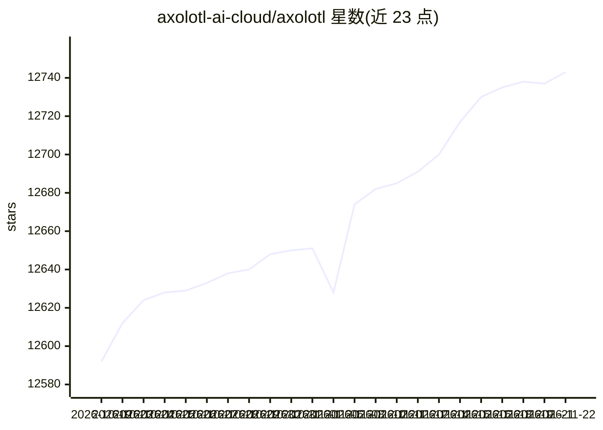

# axolotl-ai-cloud/axolotl

⭐ 12,743 · Python · Apache-2.0 · 推送 2026-11-20 · [GitHub](https://github.com/axolotl-ai-cloud/axolotl) · [官网](https://docs.axolotl.ai) · 组织维护

**面向开发者的开源 LLM 微调与后训练框架**

Axolotl 是一个开源的 LLM 后训练与微调工具，覆盖全量微调、LoRA/QLoRA、量化感知训练、偏好调优（DPO/IPO/KTO/ORPO）与 RL（GRPO/GDPO）等方法，支持文本、视觉与音频多模态模型。用户通过单个 YAML 配置文件贯穿数据预处理、训练、评估、量化与推理。提供 Docker 镜像与 PyPI 包，支持 FSDP2/DeepSpeed 单机多卡与 Torchrun/Ray 多节点训练；要求 NVIDIA（Ampere 及以上）或 AMD GPU，Python ≥3.12。

## 筛选速览

| 维度 | 判定 | 备注 |
|---|---|---|
| AI 角色 | `ai-ecosystem` | LLM/agent 周边工具 |
| 许可风险 | `permissive` | Apache-2.0 |
| 部署形态 | `self-host` | docker 或自建部署 |
| 模型依赖 | local-ok | 支持本地模型 |
| 硬件要求 | — | 无带数字的原话,不猜 |
| 安装摩擦 | `low` | 无编译、无系统依赖或容器化 |
| 成熟度 | — | 结构信号不足 |

## 能力要点

- 单 YAML 配置贯通数据预处理、训练、评估、量化与推理
- 支持全量微调、LoRA/QLoRA、QAT（int8/int4/FP8/NVFP4/MXFP4）、DPO/GRPO 等多种训练方法
- 支持多模态（图像/视频/音频）与 Hugging Face Hub 上的多类模型
- 提供 Docker 镜像、PyPI 包及多云平台部署入口

## 适用场景

- 在本地或多 GPU 环境微调开源 LLM
- 对视觉语言模型做 LoRA 微调
- 训练后导出 GGUF 并量化以部署到推理运行时
- 通过云端 GPU 平台提交微调任务

## 场景标签

`微调` `模型量化` `强化学习` · 领域:训练与推理

## 证据(README 行号)

> L81: Axolotl is a free and open-source tool designed to streamline post-training and fine-tuning for the latest large la
> L88: - **Easy Configuration**: Re-use a single YAML configuration file across the full fine-tuning pipeline: dataset pre
> L91: - **Cloud Ready**: We ship Docker images and also PyPI packages for use on cloud platforms and local hardware.

## 星数曲线

2026-10-19 12,592 → 2026-11-22 12,743（+151）

---
*卡片 v1 · prompt 1.4 · 生成 2026-11-22 · 置信度 high · 依据 README sha `47f1d3bc5a7b` · [字段定义](../../DATASET.md)*
