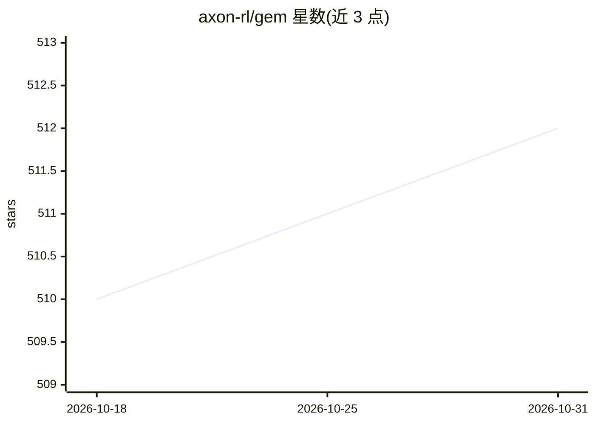

# axon-rl/gem

⭐ 512 · Python · Apache-2.0 · 推送 2026-01-21 · [GitHub](https://github.com/axon-rl/gem) · [官网](https://arxiv.org/pdf/2510.01051) · 组织维护

**面向 Agentic LLM 的强化学习环境套件（Gym 式）**

GEM（General Experience Maker）是开源的 LLM 智能体环境套件，采用类似 OpenAI Gym 的标准化 API，用于通过在线强化学习训练 agentic LLM。训练框架无关，提供与 Oat、Tinker、Verl 等 6 个 RL 训练框架的集成。环境覆盖游戏、数学、代码、QA 与推理五类任务，支持 Python 执行器、搜索引擎与 MCP 三种工具，内置 REINFORCE、GRPO、PPO 等算法实现与基准结果，并提供异步向量化执行与多环境训练。

## 筛选速览

| 维度 | 判定 | 备注 |
|---|---|---|
| AI 角色 | `ai-ecosystem` | LLM/agent 周边工具 |
| 许可风险 | `permissive` | Apache-2.0 |
| 部署形态 | `library` | 以包/库形式分发 |
| 模型依赖 | — | README 未给出锁定关系 |
| 硬件要求 | — | 无带数字的原话,不猜 |
| 安装摩擦 | `low` | 无编译、无系统依赖或容器化 |
| 成熟度 | — | 结构信号不足 |

## 能力要点

- Gym 式标准化环境 API，训练框架无关
- 集成 Oat/Tinker/Verl/RL2/ROLL/OpenRLHF 六个 RL 框架
- 五类任务环境（游戏/数学/代码/QA/推理）与 Python/Search/MCP 工具
- 内置 REINFORCE/GRPO/PPO/ReBN 算法实现与基准

## 适用场景

- 为 agentic LLM 搭建在线强化学习训练环境
- 在不同 RL 训练框架间复用同一套 benchmark 环境
- 研究多轮环境与工具调用下的 RL 算法表现

## 场景标签

`强化学习` · 领域:训练与推理

## 证据(README 行号)

> L13: As a step toward this, we introduce **GEM** — a **G**eneral **E**xperience **M**aker for LLMs — an open-source envi
> L15: Like OpenAI Gym for traditional RL, GEM provides a standardized API and a growing collection of diverse environment

## 星数曲线

2026-10-18 510 → 2026-10-31 512（+2）

---
*卡片 v1 · prompt 1.4 · 生成 2026-10-22 · 置信度 high · 依据 README sha `e2cab51c393d` · [字段定义](../../DATASET.md)*
