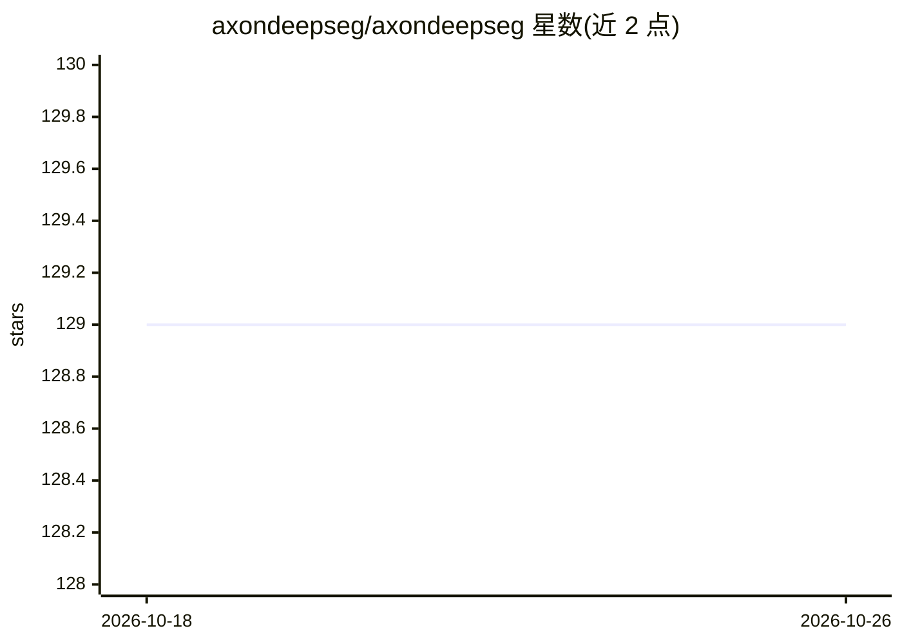

# axondeepseg/axondeepseg

⭐ 129 · Python · MIT · 推送 2026-10-21 · [GitHub](https://github.com/axondeepseg/axondeepseg) · [官网](https://axondeepseg.rtfd.io/) · 组织维护

**显微图像中轴突与髓鞘分割的深度学习工具（Python/TensorFlow）**

面向神经科学研究者：读取显微图像（电子显微镜/组织学），基于卷积神经网络将像素分类为轴突、髓鞘或背景，输出分割结果。以 Python 包形式提供，另含 Napari 插件。配套教程视频与多篇发表论文（Scientific Reports 2018 等），由 NeuroPoly（蒙特利尔理工学院）团队维护，MIT 许可。

## 筛选速览

| 维度 | 判定 | 备注 |
|---|---|---|
| AI 角色 | `ai-native` | 本体是模型或模型工具 |
| 许可风险 | `permissive` | MIT |
| 部署形态 | `None` |  |
| 模型依赖 | — | README 未给出锁定关系 |
| 硬件要求 | — | 无带数字的原话,不猜 |
| 安装摩擦 | `low` | 无编译、无系统依赖或容器化 |
| 成熟度 | — | 结构信号不足 |

## 能力要点

- CNN 像素级三分类：轴突/髓鞘/背景
- 基于 TensorFlow 的 Python 实现
- 提供 Napari 插件与教程视频

## 适用场景

- 从显微镜数据中自动分割轴突与髓鞘
- 组织学或电镜图像的髓鞘形态定量分析前置步骤

## 场景标签

`目标检测` · 领域:感知与多模态

## 证据(README 行号)

> L9: Segment axon and myelin from microscopy data using deep learning. Written in Python. Using the TensorFlow framework.
> L10: Based on a convolutional neural network architecture. Pixels are classified as either axon, myelin or background.

## 星数曲线

2026-10-18 129 → 2026-10-26 129（+0）

---
*卡片 v1 · prompt 1.4 · 生成 2026-10-22 · 置信度 high · 依据 README sha `376ab2581483` · [字段定义](../../DATASET.md)*
