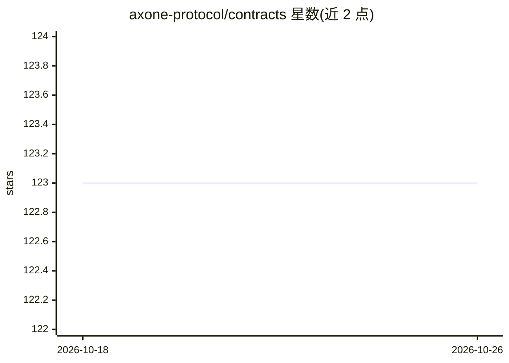

# axone-protocol/contracts

⭐ 123 · Rust · BSD-3-Clause · 推送 2026-10-13 · [GitHub](https://github.com/axone-protocol/contracts) · [官网](https://axone.xyz) · 组织维护

**AXONE 区块链协议的 CosmWasm 智能合约集（治理与凭证）**

AXONE 网络（基于 Cosmos 的区块链）的核心智能合约仓库，用 Rust 编写、编译为 CosmWasm WASM，构建于 Abstract SDK 之上。当前含两个合约：axone-gov（治理引擎，用 Prolog 规则在 Abstract Account 上定义并执行治理规则，状态 intermediate）与 axone-vc（链上可验证凭证的提交、吊销、暂停与验证，状态 initial）。开发环境用 Nix/direnv 提供，任务经 cargo-make 管理编译、测试、本地链启动与多网络部署，文档由 schema 生成。README 标注各合约成熟度等级并附 2024 年审计报告。

## 筛选速览

| 维度 | 判定 | 备注 |
|---|---|---|
| AI 角色 | `ai-ecosystem` | LLM/agent 周边工具 |
| 许可风险 | `permissive` | BSD-3-Clause |
| 部署形态 | `None` |  |
| 模型依赖 | — | README 未给出锁定关系 |
| 硬件要求 | — | 无带数字的原话,不猜 |
| 安装摩擦 | `low` | 无编译、无系统依赖或容器化 |
| 成熟度 | `idea` | |

## 能力要点

- axone-gov：基于 Prolog 规则的链上治理引擎（intermediate）
- axone-vc：RDF 数据集格式的可验证凭证生命周期管理（initial）
- cargo-make 统一管理编译/测试/本地链/部署任务
- 合约成熟度分级标注（Genesis/Initial/Intermediate/Mature）

## 适用场景

- 在 AXONE 网络上为资源实现可编程的链上治理规则
- 链上签发与验证可验证凭证
- 本地或测试网部署、测试 AXONE 协议合约

## 场景标签

 · 领域:区块链/Web3 基础设施

## 证据(README 行号)

> L10: > CosmWasm contracts for the AXONE network.
> L26: Built on **CosmWasm** and the **Abstract SDK**, these contracts constitute the **functional core** of the protocol.

## 星数曲线

2026-10-18 123 → 2026-10-26 123（+0）

---
*卡片 v1 · prompt 1.4 · 生成 2026-10-23 · 置信度 mid · 依据 README sha `a3034e07156c` · [字段定义](../../DATASET.md)*
