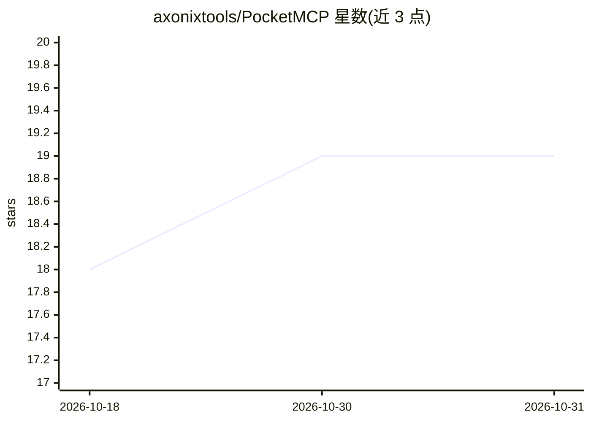

# axonixtools/PocketMCP

⭐ 19 · Kotlin · MIT · 推送 2026-10-17 · [GitHub](https://github.com/axonixtools/PocketMCP) · 个人维护

**把 Android 手机变成 MCP 服务器，供 AI agent 远程调用**

在 Android 设备上运行 MCP（Model Context Protocol）服务器的应用：通过 LAN 或 Tailscale 让桌面端 AI agent 与脚本以 JSON-RPC 调用手机能力，内置 33 个工具，覆盖通话、多平台消息（WhatsApp/Instagram/Messenger）、社媒操作、通知监控、定位、应用启动、屏幕点击滚动、语音录制与转写、shell（带安全过滤）等。基于 Kotlin/Ktor 与 Jetpack Compose 构建，以 Android 前台服务维持服务器存活，采用 API key 认证与 Android Keystore 加密存储；实验性 intelligent_action 提供自然语言多步任务编排。提供 debug APK（v1.0.0-beta.9，标为 pre-release）经 ADB 安装，或从源码 Gradle 构建。

## 筛选速览

| 维度 | 判定 | 备注 |
|---|---|---|
| AI 角色 | `ai-ecosystem` | LLM/agent 周边工具 |
| 许可风险 | `permissive` | MIT |
| 部署形态 | `library` | 以包/库形式分发 |
| 模型依赖 | — | README 未给出锁定关系 |
| 硬件要求 | — | 无带数字的原话,不猜 |
| 安装摩擦 | `medium` | 含编译或系统依赖之一 |
| 成熟度 | `idea` | |

## 能力要点

- 33 个内置工具：通话、消息、社媒、通知监控、定位、shell、屏幕自动化等
- 实验性 intelligent_action 多步任务编排（意图解析/任务图规划/重试与风险门控）
- API key 认证 + Android Keystore 加密存储 + 命令安全过滤
- 支持 LAN 或 Tailscale 远程访问，应用内自托管更新源

## 适用场景

- 让桌面端 AI agent 或脚本操作手机：发消息、打电话、查通知与电量
- 通过 MCP 自动化 Instagram/YouTube/X 等应用的交互
- 语音录制与音频转写（含 WhatsApp 语音消息）
- 手机诊断与查找：定位、响铃振动、位置查询

## 场景标签

`GUI 自动化` `语音识别` · 领域:效率与自动化

## 证据(README 行号)

> L5: Turn your Android phone into an MCP (Model Context Protocol) server.
> L6: AI agents and desktop scripts can call your phone for live data and actions over LAN or Tailscale.

## 星数曲线

2026-10-18 18 → 2026-10-31 19（+1）

---
*卡片 v1 · prompt 1.4 · 生成 2026-10-29 · 置信度 mid · 依据 README sha `39c612509539` · [字段定义](../../DATASET.md)*
