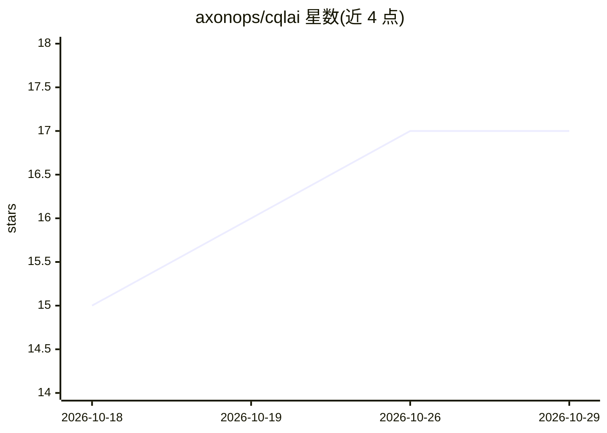

# axonops/cqlai

⭐ 17 · Go · Apache-2.0 · 推送 2026-10-16 · [GitHub](https://github.com/axonops/cqlai) · [官网](https://axonops.com) · 组织维护

**面向 Cassandra 的现代终端 CQL Shell，可选 AI 自然语言生成 CQL**

用 Go 编写的单二进制交互式 CQL 终端，作为 cqlsh 的替代：支持完整 CQL 操作与元命令、客户端侧命令解析、SSL/TLS 认证、CSV/Parquet 导入导出、批量模式、模式浏览器与保存连接等。AI 功能完全可选，无 API key 也可作为纯 CQL shell 使用；配置后支持自然语言转 CQL、查询 trace 分析与表结构评审，并可经 MCP Server 让 AI 助手只读访问集群。提供预编译二进制、go install、源码编译与 Docker 多种安装方式。

## 筛选速览

| 维度 | 判定 | 备注 |
|---|---|---|
| AI 角色 | `ai-enhanced` | 去掉 AI 部分产品仍成立 |
| 许可风险 | `permissive` | Apache-2.0 |
| 部署形态 | `desktop` | 安装包/桌面程序 |
| 模型依赖 | local-ok | 支持本地模型 |
| 硬件要求 | — | 无带数字的原话,不猜 |
| 安装摩擦 | `low` | 无编译、无系统依赖或容器化 |
| 成熟度 | — | 结构信号不足 |

## 能力要点

- 单静态二进制分发，无外部依赖（对比 cqlsh 需 Python）
- 可选 AI：自然语言生成 CQL（OpenAI/Anthropic/Gemini/Ollama/OpenRouter）、trace 分析、schema 评审
- 内置 MCP Server（cqlai mcp），允许 AI 助手受限只读访问集群并带审计日志
- COPY TO/FROM 支持 CSV 与 Parquet 格式，含 Hive 分区与 schema 推断

## 适用场景

- 日常交互式查询和管理 Cassandra 集群，替代 cqlsh
- 用自然语言生成 CQL 语句（DDL/DML），执行前预览确认
- 让 AI 助手通过 MCP 读取集群数据做分析
- 脚本化批量执行 CQL 并以 JSON/CSV 输出结果

## 场景标签

`数据分析` · 领域:效率与自动化

## 证据(README 行号)

> L11: **CQLAI** is a fast, portable interactive terminal for Cassandra (CQL), built in Go. It provides a modern, user-fri
> L13: **AI features are completely optional** - CQLAI works perfectly as a standalone CQL shell without any AI configurat
> L94:  - **Requires API key configuration** - not needed for core functionality.

## 星数曲线

2026-10-18 15 → 2026-10-29 17（+2）

---
*卡片 v1 · prompt 1.4 · 生成 2026-10-29 · 置信度 high · 依据 README sha `519f69885d52` · [字段定义](../../DATASET.md)*
