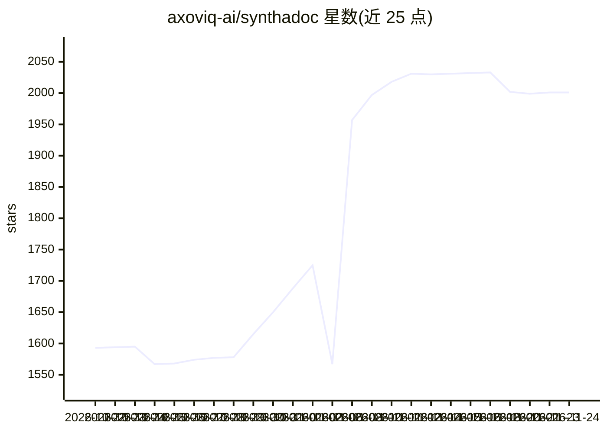

# axoviq-ai/synthadoc

⭐ 2,001 · Python · AGPL-3.0 · 推送 2026-11-22 · [GitHub](https://github.com/axoviq-ai/synthadoc) · [官网](https://axoviq.com/resources/synthadoc) · 组织维护

**把文档编译为可溯源结构化本地 wiki 的 LLM 知识引擎**

Synthadoc 在摄取时而非查询时用 LLM 将 PDF、表格、PPT、网页、视频、AI 会话记录等源文档合成持久化 Markdown wiki：自动建立交叉引用与矛盾检测、孤儿页标记、每条声明附 `^[file:L-L]` 行级引用并可通过第二 LLM 对抗审查。所有摄取、查询与成本事件写入不可变审计库，支持软告警/硬门限费用控制、三层缓存、REST API、12 工具 MCP 服务器、Docker 镜像与 Obsidian 集成。AGPL-3.0 许可，面向个人、小团队与合规敏感的企业知识库。

## 筛选速览

| 维度 | 判定 | 备注 |
|---|---|---|
| AI 角色 | `ai-native` | 本体是模型或模型工具 |
| 许可风险 | `viral` | AGPL-3.0 |
| 部署形态 | `desktop` | 安装包/桌面程序 |
| 模型依赖 | local-ok | 支持本地模型 |
| 硬件要求 | — | 无带数字的原话,不猜 |
| 安装摩擦 | `low` | 无编译、无系统依赖或容器化 |
| 成熟度 | — | 结构信号不足 |

## 能力要点

- 摄取时编译知识并自动建 wikilink 图与 Louvain 主题聚类
- 每条声明带行级引用，并有按行核验的忠实性检查
- 九类对话式维护工作流，diff 预览、确认写入、可回滚
- 不可变审计日志与软告警/硬门限成本阈值

## 适用场景

- 把分散的 PDF/网页/会议记录汇成一个长期维护的知识库
- 企业合规场景下全程本地化、留审计痕迹的知识平台
- 个人研究 wiki 用免费 Gemini Flash 或本地 Ollama 零成本运行
- 多个 wiki 间跨库提问并标注知识空白

## 场景标签

`知识库管理` `知识图谱` · 领域:知识与检索

## 证据(README 行号)

> L33: Synthadoc reads your raw source documents — PDFs, spreadsheets, PPTs, web pages, images, videos, Word files, TXTs, 
> L98: Most knowledge-management tools retrieve and summarize at query time. Synthadoc inverts this: it **compiles knowled
> L109: |Provider choice|LLM backends including free-tier Gemini and Groq, paid Anthropic/OpenAI/DeepSeek/MiniMax/Qwen (Da

## 星数曲线

2026-10-22 1,593 → 2026-11-24 2,001（+408）

---
*卡片 v1 · prompt 1.4 · 生成 2026-11-24 · 置信度 mid · 依据 README sha `1a9f4a4b9d22` · [字段定义](../../DATASET.md)*
