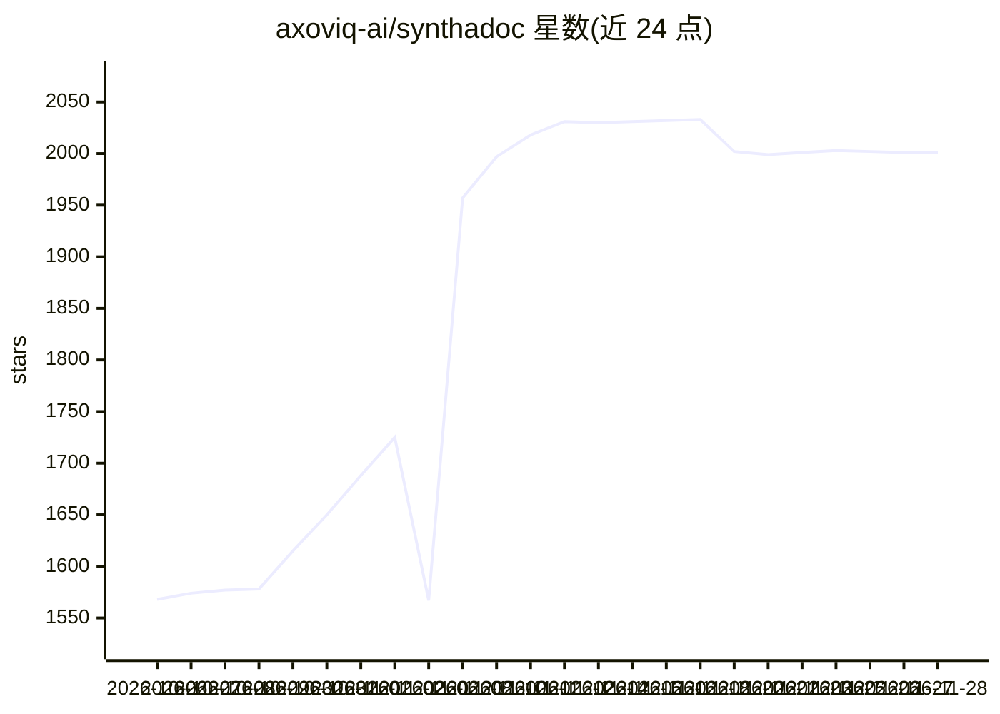

# axoviq-ai/synthadoc

⭐ 2,001 · Python · AGPL-3.0 · 推送 2026-11-27 · [GitHub](https://github.com/axoviq-ai/synthadoc) · [官网](https://axoviq.com/resources/synthadoc) · 组织维护

**把原始文档用 LLM 编译为可审计本地 wiki 的知识引擎**

Synthadoc 读取 PDF、表格、PPT、网页、图片、视频、Word、TXT 及 AI 会话记录等原始文档，在摄取阶段用 LLM 将其合成为带交叉引用的持久化 Markdown wiki，而非查询时的 RAG 检索。内置不可变 audit.db 审计日志、成本软告警与硬阈值、三层缓存、9 个对话式维护工作流（矛盾/孤儿页/断链修复）、逐条声明 `^[file:L-L]` 引用与跨 wiki 查询。输出为纯 Markdown，可在 Obsidian 或任意编辑器中离线使用；提供 CLI、Web UI、REST API、12 工具 MCP 服务器与 Docker 镜像，AGPL-3.0 许可。

## 筛选速览

| 维度 | 判定 | 备注 |
|---|---|---|
| AI 角色 | `ai-native` | 本体是模型或模型工具 |
| 许可风险 | `viral` | AGPL-3.0 |
| 部署形态 | `desktop` | 安装包/桌面程序 |
| 模型依赖 | local-ok | 支持本地模型 |
| 硬件要求 | — | 无带数字的原话,不猜 |
| 安装摩擦 | `low` | 无编译、无系统依赖或容器化 |
| 成熟度 | — | 结构信号不足 |

## 能力要点

- 摄取时编译：新来源自动交叉链接并检测矛盾，wiki 为纯 Markdown 离线可读
- 每个声明带 `^[file:L-L]` 引用，附 Source Viewer 与引用忠实性检查
- 9 个对话式维护工作流，写入前预览 diff 并可回滚
- immutable audit.db 记录每次摄取、查询与成本事件，支持软告警与硬阈值

## 适用场景

- 把积累的研究或团队文档编译成可溯源的内部知识库
- 合规敏感场景下在本地维护带审计日志的知识库
- 用维护工作流自动发现并处理 wiki 中的矛盾与孤儿页
- 用一个查询跨多个注册 wiki 检索并带引用作答

## 场景标签

`知识库管理` · 领域:知识与检索

## 证据(README 行号)

> L33: Synthadoc reads your raw source documents — PDFs, spreadsheets, PPTs, web pages, images, videos, Word files, TXTs, 
> L98: Most knowledge-management tools retrieve and summarize at query time. Synthadoc inverts this: it **compiles knowled
> L109: |Provider choice|LLM backends including free-tier Gemini and Groq, paid Anthropic/OpenAI/DeepSeek/MiniMax/Qwen (Da

## 星数曲线

2026-10-26 1,568 → 2026-11-28 2,001（+433）

---
*卡片 v1 · prompt 1.4 · 生成 2026-11-28 · 置信度 mid · 依据 README sha `3b3acb838f7b` · [字段定义](../../DATASET.md)*
