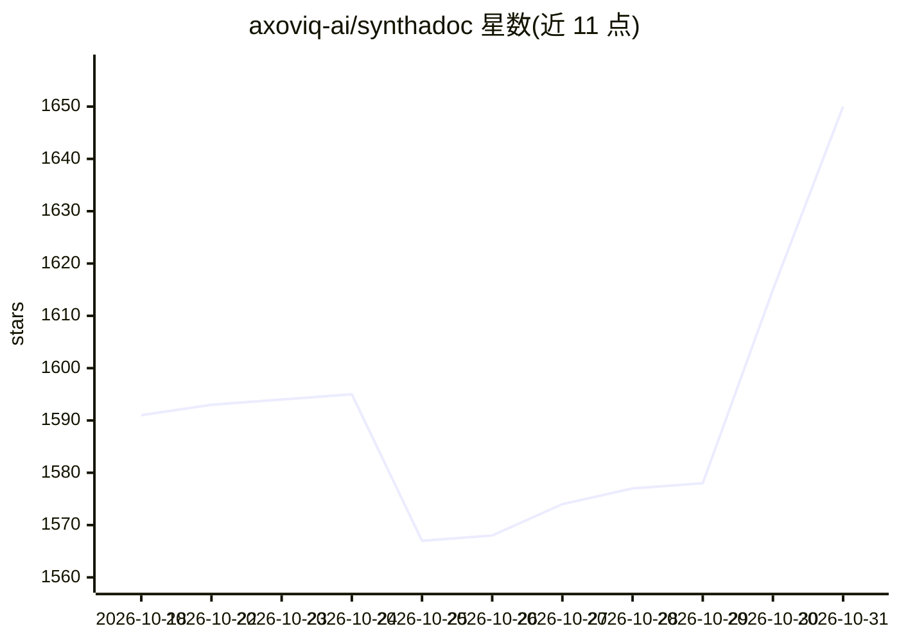

# axoviq-ai/synthadoc

⭐ 1,650 · Python · AGPL-3.0 · 推送 2026-10-30 · [GitHub](https://github.com/axoviq-ai/synthadoc) · [官网](https://axoviq.com/resources/synthadoc) · 组织维护

**把原始文档编译为本地优先结构化 wiki 的 LLM 知识引擎**

Synthadoc 在摄入时用 LLM 将 PDF、表格、网页、视频、Word 及 AI 会话转录等多种来源合成为持久的本地 Markdown wiki，而非查询时检索：自动构建 wikilink 加权知识图、检测并标记矛盾、逐条声明附来源引用，页面有 draft→active→contradicted/stale→archived 五态生命周期。面向个人、小团队与合规敏感的企业，支持免费 Gemini/Groq、付费 Anthropic/OpenAI/DeepSeek/Qwen 及本地 Ollama 等后端，提供 CLI、Obsidian 插件、Web UI 与 MCP 四种接口；本地优先、localhost-only 绑定，附 token/成本日志。限制：引用标注质量依赖模型（建议 Gemini 2.5 Flash 及以上）。

## 筛选速览

| 维度 | 判定 | 备注 |
|---|---|---|
| AI 角色 | `ai-ecosystem` | LLM/agent 周边工具 |
| 许可风险 | `viral` | AGPL-3.0 |
| 部署形态 | `desktop` | 安装包/桌面程序 |
| 模型依赖 | local-ok | 支持本地模型 |
| 硬件要求 | — | 无带数字的原话,不猜 |
| 安装摩擦 | `low` | 无编译、无系统依赖或容器化 |
| 成熟度 | — | 结构信号不足 |

## 能力要点

- 摄入时编译知识：矛盾检测、孤儿页 lint、claim 级 file:L-L 来源引用
- 5 态页面生命周期与不可变事件日志
- 自动 wikilink 加权图 + Louvain 聚类 + D3 可视化
- 3 层缓存（embedding/LLM/prompt）使未变更页重复 lint 近零 token

## 适用场景

- 把分散的研究资料与内部文档沉淀为可审计的结构化 wiki
- 合规敏感场景下在本地维护带引用与矛盾标记的知识库
- 尽调类项目（如演示的 M&A 案例）中做来源可追溯的知识整理

## 场景标签

`知识库管理` `知识图谱` · 领域:知识与检索

## 证据(README 行号)

> L29: Synthadoc reads your raw source documents — PDFs, spreadsheets, PPTs, web pages, images, videos, Word files, TXTs, 
> L83: |Provider choice|LLM backends including free-tier Gemini and Groq, paid Anthropic/OpenAI/DeepSeek/MiniMax/Qwen (Das

## 星数曲线

2026-10-18 1,591 → 2026-10-31 1,650（+59）

---
*卡片 v1 · prompt 1.4 · 生成 2026-10-21 · 置信度 mid · 依据 README sha `17faa4e2cdbb` · [字段定义](../../DATASET.md)*
