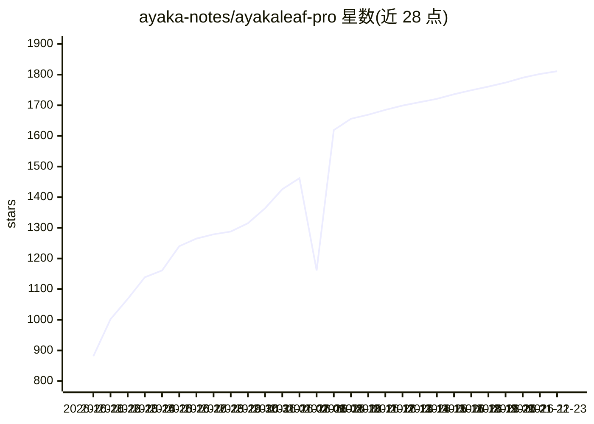

# ayaka-notes/ayakaleaf-pro

⭐ 1,811 · JavaScript · AGPL-3.0 · 推送 2026-11-19 · [GitHub](https://github.com/ayaka-notes/ayakaleaf-pro) · [官网](https://ayakaleaf-home.ayaka.space/) · 组织维护

**自托管开源 LaTeX 编辑器，替代 Overleaf 社区版并补充其专业版功能**

基于 Overleaf Community Edition 的增强分支，面向需要自托管 LaTeX 协作写作环境的用户。提供双双向 Dropbox/GitHub/GitLab/Gitea 同步、Git-Bridge、Zotero/Mendeley 集成、Track Changes、完整项目历史、沙盒编译（texlive-full 镜像）、模板系统、管理面板、LDAP/SAML/OAuth 2.0 SSO，以及 AI 聊天助手、编译错误解释修复助手和供 AI Agent 编辑编译评论的 MCP Server。支持 18 种语言界面与 Docker x86_64/arm64 部署；项目独立于 Overleaf, Inc.，采用 AGPL-3.0 许可。

## 筛选速览

| 维度 | 判定 | 备注 |
|---|---|---|
| AI 角色 | `ai-enhanced` | 去掉 AI 部分产品仍成立 |
| 许可风险 | `viral` | AGPL-3.0 |
| 部署形态 | `desktop` | 安装包/桌面程序 |
| 模型依赖 | — | README 未给出锁定关系 |
| 硬件要求 | — | 无带数字的原话,不猜 |
| 安装摩擦 | `low` | 无编译、无系统依赖或容器化 |
| 成熟度 | — | 结构信号不足 |

## 能力要点

- AI 聊天助手与编译错误解释修复助手
- MCP Server 使 AI Agent 可编辑、编译和评论项目
- Dropbox/GitHub/GitLab/Gitea 双向同步与 Git-Bridge
- 沙盒编译（texlive-full 镜像）与 SSO（LDAP/SAML/OAuth 2.0）

## 适用场景

- 为团队或学校自建 LaTeX 在线协作写作平台
- 通过 Git 或 Dropbox 在本地与在线项目间同步稿件
- 用 AI 助手解释和修复 LaTeX 编译错误
- 对接 Zotero/Mendeley 管理参考文献

## 场景标签

 · 领域:学术写作/文档协作工具

## 证据(README 行号)

> L38: Ayakaleaf Pro is an enhanced version of Overleaf with almost all features and capabilities. For details, please che
> L41: - MCP Server (Let AI Agents Edit, Compile and Comment)
> L64: - ARM Support(x86_64/arm64 on Docker)

## 星数曲线

2026-10-21 881 → 2026-11-23 1,811（+930）

---
*卡片 v1 · prompt 1.4 · 生成 2026-11-23 · 置信度 high · 依据 README sha `c27587e19d96` · [字段定义](../../DATASET.md)*
