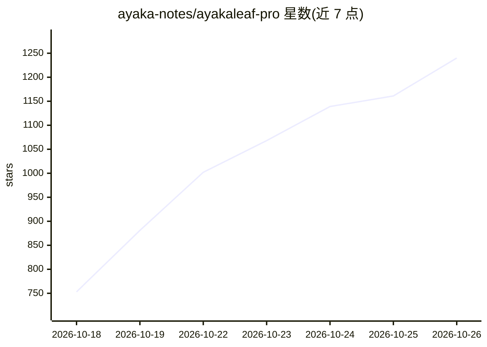

# ayaka-notes/ayakaleaf-pro

⭐ 1,240 · JavaScript · AGPL-3.0 · 推送 2026-10-25 · [GitHub](https://github.com/ayaka-notes/ayakaleaf-pro) · [官网](https://ayakaleaf-home.ayaka.space/) · 组织维护

**自托管的 Overleaf 社区版增强版，补齐 Pro 功能与 AI 助手**

对 Overleaf Community Edition 进行增强并自行托管部署的 LaTeX 在线编辑平台：在开源免费基础上补入接近 Pro 版的功能，包括 SSO（LDAP/SAML/OAuth 2.0）、双向 GitHub/GitLab/Dropbox 同步、修订追踪、沙箱编译、Zotero/Mendeley 集成，以及 AI 相关能力——AI 聊天助手、编译错误解释修复助手、供 AI Agent 编辑/编译/评论的 MCP Server。通过 Docker 镜像与 Toolkit 安装，另有 GitHub Codespaces Playground 试用环境。AGPLv3 许可，与 Overleaf 公司无关联。

## 筛选速览

| 维度 | 判定 | 备注 |
|---|---|---|
| AI 角色 | `ai-enhanced` | 去掉 AI 部分产品仍成立 |
| 许可风险 | `viral` | AGPL-3.0 |
| 部署形态 | `desktop` | 安装包/桌面程序 |
| 模型依赖 | — | README 未给出锁定关系 |
| 硬件要求 | — | 无带数字的原话,不猜 |
| 安装摩擦 | `low` | 无编译、无系统依赖或容器化 |
| 成熟度 | — | 结构信号不足 |

## 能力要点

- AI 聊天助手与编译错误解释修复助手
- MCP Server 供 AI Agent 编辑、编译与评论文档
- SSO（LDAP/SAML/OAuth 2.0）与 Git/GitHub/GitLab/Dropbox 双向同步
- 沙箱编译（texlive-full 镜像）与 Docker x86_64/arm64 支持

## 适用场景

- 团队或机构自托管 LaTeX 协作写作平台并接入门户登录
- 写作时用 AI 助手聊天、改稿与修复编译错误
- 经 Git 或 Dropbox 与本地及代码托管平台同步项目

## 场景标签

`AI 助手` · 领域:对话与助手

## 证据(README 行号)

> L19: Ayakaleaf Pro is an enhanced version of Overleaf with almost all features and capabilities. For details, please che
> L22: - MCP Server (Let AI Agents Edit, Compile and Comment)
> L23: - AI Chat Assistant (Chat, Edit and Fix with AI)

## 星数曲线

2026-10-18 753 → 2026-10-26 1,240（+487）

---
*卡片 v1 · prompt 1.4 · 生成 2026-10-21 · 置信度 high · 依据 README sha `9ae7fd711c56` · [字段定义](../../DATASET.md)*
