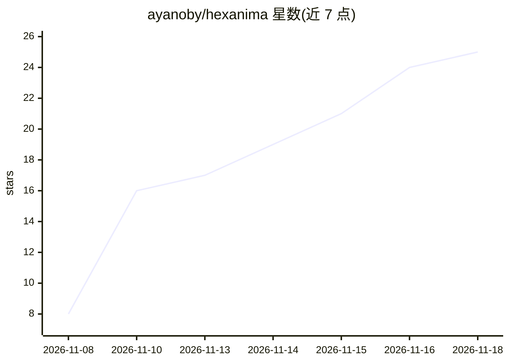

# ayanoby/hexanima

⭐ 25 · C++ · NOASSERTION · 推送 2026-11-17 · [GitHub](https://github.com/ayanoby/hexanima) · 个人维护

**在骁龙 8 Gen 1 NPU 上离线生成动漫图像的安卓应用**

Android 应用，在 Snapdragon 8 Gen 1 / 8+ Gen 1 的 Hexagon V69 NPU 上本地运行扩散模型：Anima 系列（2B/2.9B）、MOSS-Image 5B、Qwen-Image 2.1 Turbo、Mage-Flow-Edit-Turbo、MiniMax-H3-Image、FLUX.3 Klein 及 LTX-2.5 视频，全部离线执行，无需 root、云服务或账号。扩散 transformer 由自定义 HMX 内核在 NPU 运行，文生图 512x768 约 7-12 秒（Anima），部分模型权重约 14-48 GB 从存储流式读取。支持 LoRA 折叠、Danbooru 标签补全、提示词照片编辑、历史管理与 13 种语言。限制：仅限指定 SoC，部分模型许可为非商用。

## 筛选速览

| 维度 | 判定 | 备注 |
|---|---|---|
| AI 角色 | `ai-native` | 本体是模型或模型工具 |
| 许可风险 | `none` | NOASSERTION |
| 部署形态 | `desktop` | 安装包/桌面程序 |
| 模型依赖 | — | README 未给出锁定关系 |
| 硬件要求 | — | 无带数字的原话,不猜 |
| 安装摩擦 | `low` | 无编译、无系统依赖或容器化 |
| 成熟度 | — | 结构信号不足 |

## 能力要点

- 多模型在手机 NPU 上离线运行（自定义 HMX 内核）
- 支持用户自有 LoRA 在端侧校验与折叠（Anima/MOSS-Image）
- Qwen-Image/Mage-Flow 提供按提示词的照片编辑
- 模型下载后完全离线，数据不离开手机

## 适用场景

- 在支持的骁龙手机上离线生成动漫图像与照片
- 用自己的 LoRA 文件切换画风且不离开设备
- 按提示词编辑手机照片或生成含文字的图片

## 场景标签

`图像生成` · 领域:内容生成

## 证据(README 行号)

> L2:  Anime image generation that runs entirely on your phone's NPU.
> L9: HexAnima runs the Anima diffusion model and fine-tunes of it on the Hexagon NPU of Snapdragon 8 Gen 1 / 8+ Gen 1 pho
> L10: The diffusion transformer is executed by custom HMX kernels; the text encoder and the sampler run on the CPU.

## 星数曲线

2026-11-08 8 → 2026-11-18 25（+17）

---
*卡片 v1 · prompt 1.4 · 生成 2026-11-18 · 置信度 high · 依据 README sha `dcc261d5d268` · [字段定义](../../DATASET.md)*
