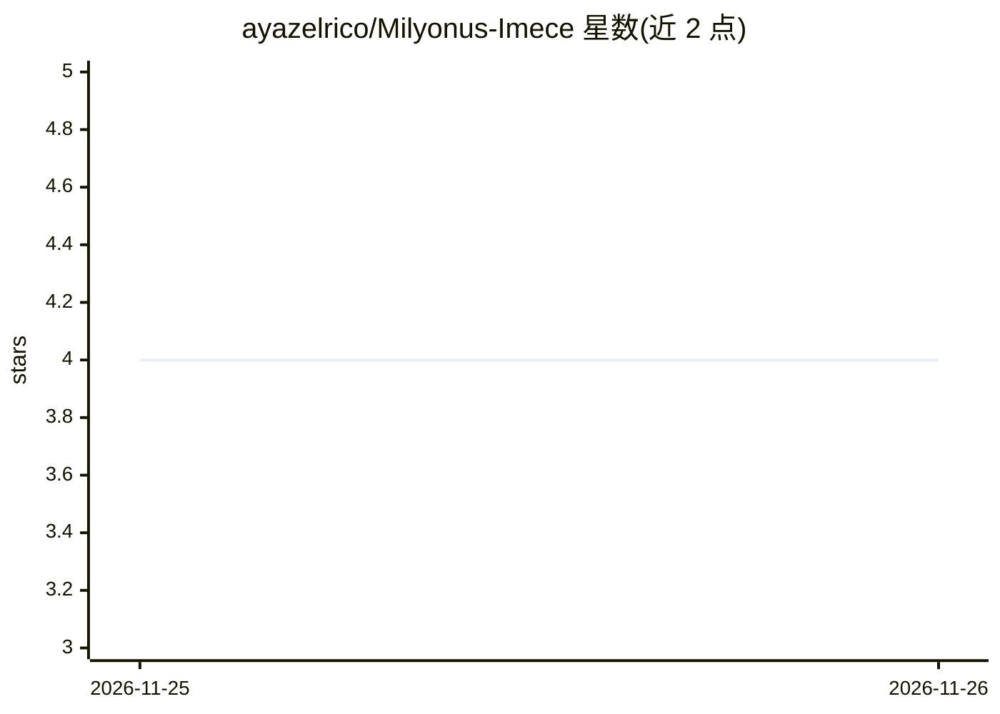

# ayazelrico/Milyonus-Imece

⭐ 4 · Python · Apache-2.0 · 推送 2026-11-09 · [GitHub](https://github.com/ayazelrico/Milyonus-Imece) · [官网](https://www.milyonus.com) · 个人维护

**多智能体协同框架：子集群干活、五模型议会决策、三道独立闸门验证**

开源多智能体集合系统，一条命令把任务送过数十至上万个真实子代理、五模型 IRADE 议会和三道独立验证闸门。子代理池按 16 个功能块分配（含下限保证与最大余数法扩缩容），flexible/independent/fixed 三类块的借调规则在代码中强制执行。流程为独立问题框定→侦察与规划→独立生产与测试设计→现实过滤→交叉批评→议会综合决策→盲审批准，各阶段边界均为人工停止检查点。README 自述状态为实验性，通过 uv 安装运行。

## 筛选速览

| 维度 | 判定 | 备注 |
|---|---|---|
| AI 角色 | `ai-native` | 本体是模型或模型工具 |
| 许可风险 | `permissive` | Apache-2.0 |
| 部署形态 | `self-host` | docker 或自建部署 |
| 模型依赖 | local-ok | 支持本地模型 |
| 硬件要求 | — | 无带数字的原话,不猜 |
| 安装摩擦 | `low` | 无编译、无系统依赖或容器化 |
| 成熟度 | `idea` | |

## 能力要点

- 数十至 10,000 子代理的加权分配算法（最大余数法，17 为最小合法运行）
- 五模型 IRADE 议会与三道独立验证闸门（框定/现实过滤/盲审批准）
- 独立块不可借调的规则由代码强制（ScaleError）而非提示词
- 自述实验性：一次真实模型运行通过 12 项独立测试与外部 oracle

## 适用场景

- 让大量子代理分工完成研究、规划、编码与测试的完整任务
- 需要独立验证层避免自我校验错误的自动化产出流程
- 在高风险任务中加入红队、合规与人工不可逆决策检查点

## 场景标签

`多智能体` `Agent 框架` · 领域:Agent 开发

## 证据(README 行号)

> L6: One command sends a task through **tens to thousands of real subagents**, a
> L35: council of five models called **IRADE** (*will, resolve*) makes the **decisions**
> L178: |14|Onay Merci (approval)|🔴|Blind final approval|`gates.approve`|

## 星数曲线

2026-11-25 4 → 2026-11-26 4（+0）

---
*卡片 v1 · prompt 1.4 · 生成 2026-11-24 · 置信度 mid · 依据 README sha `51442491dd4d` · [字段定义](../../DATASET.md)*
