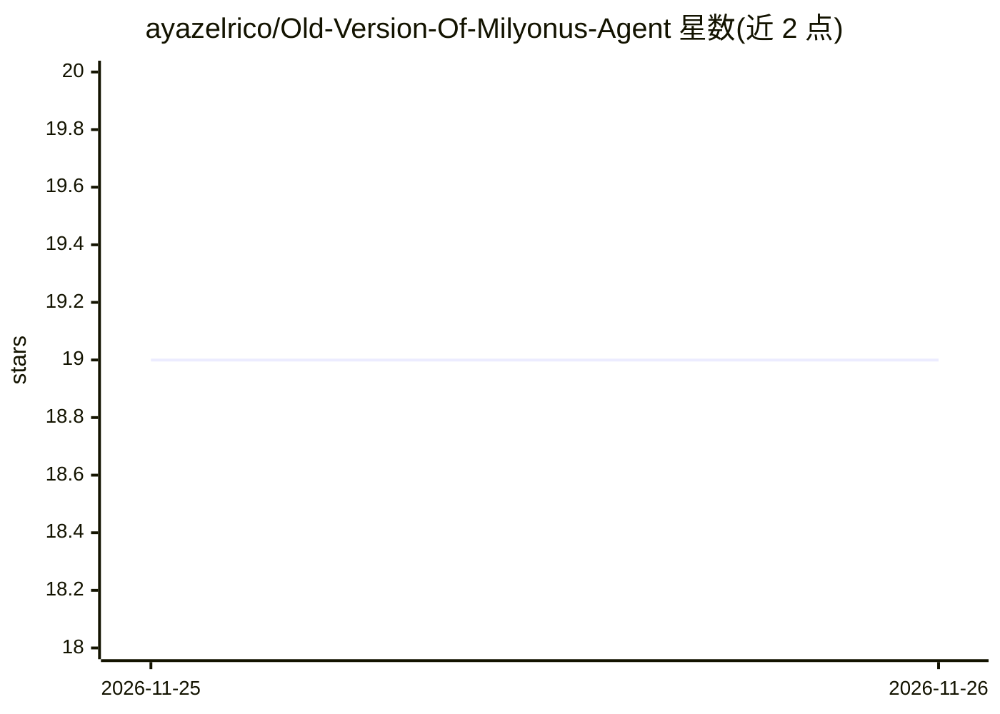

# ayazelrico/Old-Version-Of-Milyonus-Agent

⭐ 19 · Python · Apache-2.0 · 推送 2026-11-01 · [GitHub](https://github.com/ayazelrico/Old-Version-Of-Milyonus-Agent) · [官网](https://www.milyonus.com/milyonus-agent) · 个人维护

**给开发者的带验证记忆核心的开源自主 agent，抗记忆投毒**

基于 Python 的开源自主 agent，核心是「验证记忆」管线：每条候选记忆经 Ingest → Quarantine → Verify → Promote 流程写入，逐行记录来源（who/from where/evidence），并存储在 hash-chained ledger 上。信任分级（T0-T4）、信任按半衰期衰减、召回按 cosine × trust 加权排序、operator 权限用 Ed25519 两阶段签名，不可由文本伪造。同一 agent core 提供 CLI/TUI、Telegram、WhatsApp、Slack、Discord、编辑器（ACP）六种接入面，消息渠道默认拒绝、需配对码配对。安装需 uv 与 Python，Anthropic 为默认 provider。

## 筛选速览

| 维度 | 判定 | 备注 |
|---|---|---|
| AI 角色 | `ai-native` | 本体是模型或模型工具 |
| 许可风险 | `permissive` | Apache-2.0 |
| 部署形态 | `self-host` | docker 或自建部署 |
| 模型依赖 | local-ok | 支持本地模型 |
| 硬件要求 | — | 无带数字的原话,不猜 |
| 安装摩擦 | `low` | 无编译、无系统依赖或容器化 |
| 成熟度 | — | 结构信号不足 |

## 能力要点

- 无直接写路径的记忆管线：Ingest → Quarantine → Verify → Promote
- hash-chained ledger 与逐行 provenance（memory why / revoke / audit verify）
- 信任衰减半衰期机制，人工 reaffirm 限流且收益递减
- 六种接入面（CLI/Telegram/WhatsApp/Slack/Discord/ACP）统一 default-deny 配对

## 适用场景

- 搭建跨会话持久记忆且需防记忆投毒的个人 agent
- 通过 Telegram/Slack/Discord 等聊天渠道使用同一个 agent
- 需要可审计的记忆来源链与撤销级联的 agent 部署
- 在 Zed 等 ACP 编辑器中接入 agent 会话

## 场景标签

`Agent 记忆` `Agent 框架` · 领域:Agent 开发

## 证据(README 行号)

> L5: An open-source, self-improving autonomous agent with a **verified-memory core** —
> L57: Multi-provider: **Anthropic** (default, most poisoning-resistant), **OpenAI**,
> L62: The same agent core runs behind **six surfaces**, all default-deny with in-chat approval:

## 星数曲线

2026-11-25 19 → 2026-11-26 19（+0）

---
*卡片 v1 · prompt 1.4 · 生成 2026-11-24 · 置信度 high · 依据 README sha `e66eb8a8a07b` · [字段定义](../../DATASET.md)*
