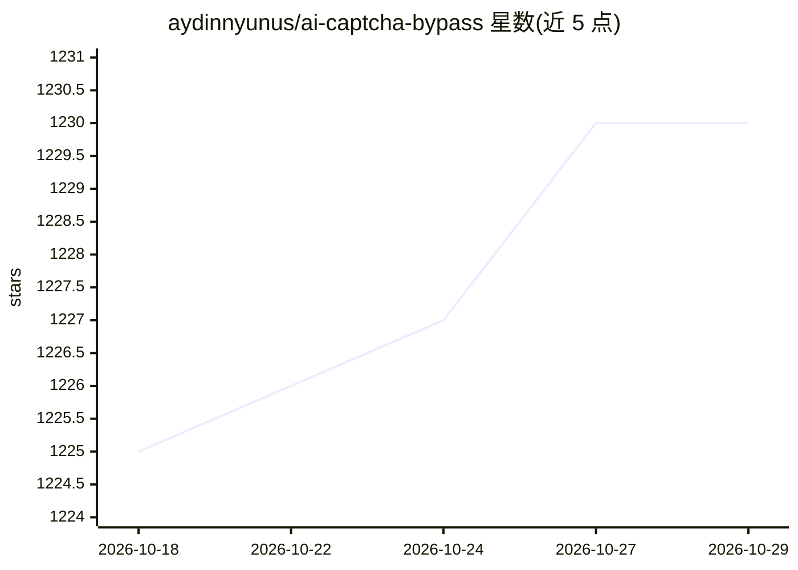

# aydinnyunus/ai-captcha-bypass

⭐ 1,230 · Python · NOASSERTION · 推送 2026-05-23 · [GitHub](https://github.com/aydinnyunus/ai-captcha-bypass) · 个人维护

**用 GPT-4o/Gemini 自动求解多种 CAPTCHA 的命令行工具**

基于 Python 的命令行工具，通过 OpenAI（GPT-4o）与 Google Gemini 等多模态模型求解文本、复杂文本、reCAPTCHA v2、滑块拼图与音频共 5 类 CAPTCHA，覆盖 2captcha.com 演示页的题型。机制上以 Selenium 驱动 Firefox 访问页面，截图或读取音频后发送给所选 AI，按返回的文本/坐标/图片选择执行操作并验证结果；成功案例保存为 GIF，另含 benchmark.py 成功率测试脚本。需配置 API key，限定 Python 3.7+ 与 Firefox。

## 筛选速览

| 维度 | 判定 | 备注 |
|---|---|---|
| AI 角色 | `ai-native` | 本体是模型或模型工具 |
| 许可风险 | `none` | NOASSERTION |
| 部署形态 | `library` | 以包/库形式分发 |
| 模型依赖 | — | README 未给出锁定关系 |
| 硬件要求 | — | 无带数字的原话,不猜 |
| 安装摩擦 | `low` | 无编译、无系统依赖或容器化 |
| 成熟度 | — | 结构信号不足 |

## 能力要点

- 支持 OpenAI 与 Gemini 双提供商，可指定模型
- 覆盖 5 类 CAPTCHA：文本/复杂文本/reCAPTCHA v2/滑块拼图/音频
- Selenium 驱动 Firefox 完成浏览器操作并自动验证结果
- 附 benchmark.py 成功率评测脚本，成功求解保存为 GIF

## 适用场景

- 在 2captcha.com 演示页测试多模态模型的 CAPTCHA 求解能力
- 对比不同 AI 提供商与模型在各类 CAPTCHA 上的成功率
- 作为扩展模板添加新的 CAPTCHA 类型或 AI 模型支持

## 场景标签

`浏览器自动化` `网络安全` · 领域:效率与自动化

## 证据(README 行号)

> L3: This project is a Python-based command-line tool that uses large multimodal models (LMMs) like OpenAI's GPT-4o and G
> L11: - **Multiple AI Providers**: Supports both OpenAI (e.g., GPT-4o) and Google Gemini (e.g., Gemini 2.5 Pro) models.

## 星数曲线

2026-10-18 1,225 → 2026-10-29 1,230（+5）

---
*卡片 v1 · prompt 1.4 · 生成 2026-10-21 · 置信度 mid · 依据 README sha `79a245327489` · [字段定义](../../DATASET.md)*
