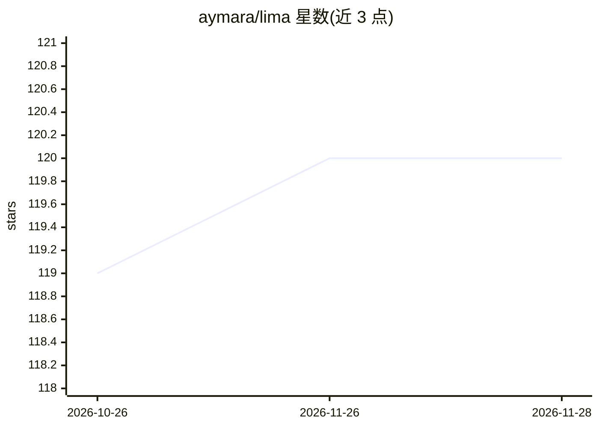

# aymara/lima

⭐ 120 · C++ · NOASSERTION · 推送 2026-11-27 · [GitHub](https://github.com/aymara/lima) · [官网](http://aymara.github.io/lima/) · 组织维护

**多语言 NLP 分析工具包：分词、词性标注、依存句法与实体抽取**

CEA LIST 开发的多语言自然语言分析 C++ 工具包，MIT 许可。神经模块（libtorch 训练、CPU 上以 Eigen 运行）提供分词、词性标注、词形还原与依存分析，覆盖 60 多种语言的模型，统一输出 CoNLL-U；ModEx 规则机制在无标注数据领域抽取实体、关系与事件。以 C++ 库、命令行、HTTP 服务和 Python 包（Linux/Windows/macOS）形式提供，支持 Docker 镜像与源码构建。无 GPU 支持，命名实体识别限于英语和法语。

## 筛选速览

| 维度 | 判定 | 备注 |
|---|---|---|
| AI 角色 | `ai-native` | 本体是模型或模型工具 |
| 许可风险 | `none` | NOASSERTION |
| 部署形态 | `library` | 以包/库形式分发 |
| 模型依赖 | — | README 未给出锁定关系 |
| 硬件要求 | — | 无带数字的原话,不猜 |
| 安装摩擦 | `low` | 无编译、无系统依赖或容器化 |
| 成熟度 | — | 结构信号不足 |

## 能力要点

- 60 多种语言的神经分词、词性、词形与依存分析，统一 CoNLL-U 输出
- ModEx 规则机制在无标注数据领域抽取实体、关系与事件
- C++ 库、命令行、HTTP 服务器、Python 包四种使用形式
- CPU 运行，README 称在 UD 2.18 测试集上约每秒分析 5,000 词

## 适用场景

- 对多语言文本做依存句法与词形分析
- 在无标注数据的领域用规则抽取实体、关系与事件
- 以 HTTP 服务形式为应用提供文本分析接口

## 场景标签

`文档解析` · 领域:知识与检索

## 证据(README 行号)

> L9: LIMA is a multilingual natural language processing analyzer developed by
> L13: - **Neural modules** (trained with libtorch, run on the CPU with Eigen) for tokenization, part-of-speech tagging an
> L31: - **Embeddable**: C++ library, command line, HTTP server and Python package;

## 星数曲线

2026-10-26 119 → 2026-11-28 120（+1）

---
*卡片 v1 · prompt 1.4 · 生成 2026-11-28 · 置信度 high · 依据 README sha `fc377b638f7e` · [字段定义](../../DATASET.md)*
