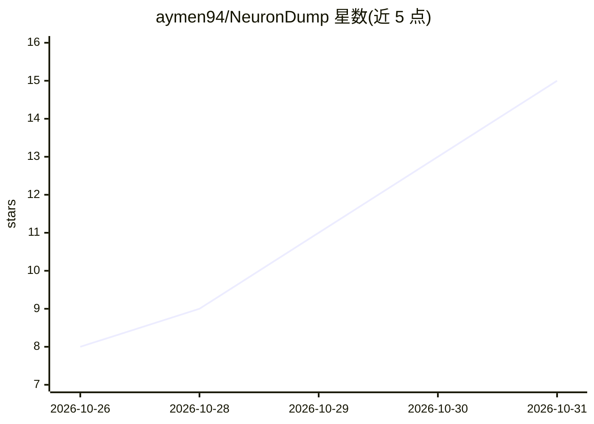

# aymen94/NeuronDump

⭐ 15 · Rust · MIT · 推送 2026-10-27 · [GitHub](https://github.com/aymen94/NeuronDump) · [官网](http://aymen.xyz/NeuronDump/) · 个人维护

**本地 GGUF 模型内部结构检视、干预与瘦身工具**

Rust 编写的 GGUF 模型检视工具：读取 Ollama、LM Studio、Hugging Face、Jan、llama.cpp 的本地 GGUF 文件，展示层、注意力头、词表、chat template 与权重统计，以 2D/3D 图形式可视化。支持 ablate/steer/patch/ban 等实时编辑（带 undo 与前后对比）、token 逐层追踪、两模型 diff，并可写出更小且仍能在 Ollama/llama.cpp 运行的新 GGUF。静态分析支持任意 GGUF 架构，运行时（trace 特性）仅支持 llama/qwen/gemma/phi3/bert 等，CPU 执行。提供 CLI、Web 界面与 HTTP API，通过 cargo 安装或下载预编译包。

## 筛选速览

| 维度 | 判定 | 备注 |
|---|---|---|
| AI 角色 | `ai-ecosystem` | LLM/agent 周边工具 |
| 许可风险 | `permissive` | MIT |
| 部署形态 | `desktop` | 安装包/桌面程序 |
| 模型依赖 | — | README 未给出锁定关系 |
| 硬件要求 | — | 无带数字的原话,不猜 |
| 安装摩擦 | `medium` | 含编译或系统依赖之一 |
| 成熟度 | `idea` | |

## 能力要点

- 任意 GGUF 架构的静态分析与 2D/3D 模型图可视化
- trace 特性下 CPU 运行模型：token 逐层追踪、生成时间线与逐层决策分解
- 实时编辑（消融/转向/patch/ban）带 undo 与基线对比，可 bake 为新 GGUF
- 按 plan 写出更小的 GGUF 与 Ollama Modelfile

## 适用场景

- 检视本地 GGUF 模型的层结构、注意力头与词表
- 通过消融与扫描找出模型中可剪除的部分并瘦身
- 对比 base 与微调模型、或剪枝前后的权重差异
- 追踪一个 token 在各层的路径以解释模型行为

## 场景标签

`模型量化` · 领域:训练与推理

## 证据(README 行号)

> L12: NeuronDump reads **GGUF** model files (the format used by **Ollama** and **llama.cpp**) and
> L14: It can then remove unused parts and write a smaller GGUF that still runs in Ollama and llama.cpp.
> L18: through every layer, see why it was chosen, and **edit the model live** (scale, zero, steer, patch,

## 星数曲线

2026-10-26 8 → 2026-10-31 15（+7）

---
*卡片 v1 · prompt 1.4 · 生成 2026-10-31 · 置信度 high · 依据 README sha `bbf88e0e32a9` · [字段定义](../../DATASET.md)*
