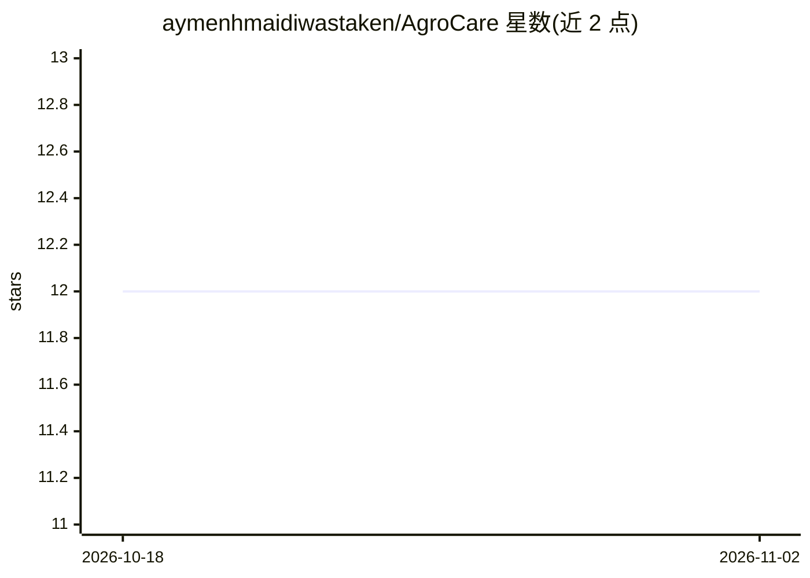

# aymenhmaidiwastaken/AgroCare

⭐ 12 · Python · 推送 2026-03-25 · [GitHub](https://github.com/aymenhmaidiwastaken/AgroCare) · 个人维护

**植物病害检测与对比分析的多版本 Streamlit 应用**

面向种植者的植物病害诊断 Web 应用：上传植物图片后由多智能体 LLM 流水线（视觉分析→症状总结→鉴别诊断→一致性校验）输出可能病害与护理建议；支持前后对比追踪病情变化，结果按用户持久化到 MongoDB 形成可查询历史。提供 bcrypt 加盐哈希认证、Cookie 会话管理，保留 V1/V2/V3 三个版本展示演进。需 Python 3.10+ 与 MongoDB 连接串，通过源码克隆安装并以 streamlit run 运行。

## 筛选速览

| 维度 | 判定 | 备注 |
|---|---|---|
| AI 角色 | `ai-native` | 本体是模型或模型工具 |
| 许可风险 | `none` | — |
| 部署形态 | `library` | 以包/库形式分发 |
| 模型依赖 | — | README 未给出锁定关系 |
| 硬件要求 | — | 无带数字的原话,不猜 |
| 安装摩擦 | `low` | 无编译、无系统依赖或容器化 |
| 成熟度 | — | 结构信号不足 |

## 能力要点

- 四步多智能体流水线：视觉分析→症状总结→鉴别诊断→一致性校验
- V2 图片对比追踪治疗前后的病情变化，结果持久化
- bcrypt 加盐哈希认证与按用户隔离的 MongoDB 持久化
- 模块化 provider 层，支持多 API 集成或回退

## 适用场景

- 上传植物照片获取可能病害与护理步骤
- 对比治疗前后照片追踪病情改善或扩散
- 回看历史诊断记录并追加随访图片

## 场景标签

`多智能体` · 领域:Agent 开发

## 证据(README 行号)

> L3: A multi-version Streamlit app (V1, V2, V3) for plant disease **detection, comparison, and history tracking**, backed
> L20:  - Agents collaborate: *Vision Analyzer* → *Symptom Summarizer* → *Differential Diagnosis* → *Consistency Checker*.

## 星数曲线

2026-10-18 12 → 2026-11-02 12（+0）

---
*卡片 v1 · prompt 1.4 · 生成 2026-11-01 · 置信度 high · 依据 README sha `14b37632e6e7` · [字段定义](../../DATASET.md)*
