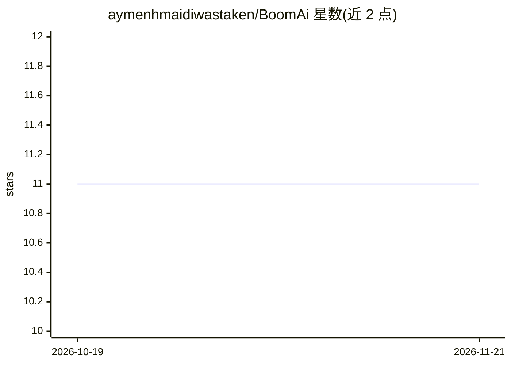

# aymenhmaidiwastaken/BoomAi

⭐ 11 · SCSS · 推送 2026-03-25 · [GitHub](https://github.com/aymenhmaidiwastaken/BoomAi) · 个人维护

**给终端用户提供文本/图像/代码 AI 生成的全栈 SaaS 平台**

基于 Next.js 14（前端）与 Laravel 11（后端）的全栈内容生成平台：提供 AI 文本生成（文章/邮件/营销文案）、文生图、代码片段生成，并配套用户认证（JWT/Sanctum）、仪表盘、定价方案、博客、联系表单与暗/亮主题。前端运行于 3000 端口，后端 API 运行于 8000 端口，使用 MySQL 8 存储数据，通过 artisan migrate --seed 初始化数据库。README 未列出各生成器所接入的具体模型或服务。

## 筛选速览

| 维度 | 判定 | 备注 |
|---|---|---|
| AI 角色 | `ai-native` | 本体是模型或模型工具 |
| 许可风险 | `none` | — |
| 部署形态 | `library` | 以包/库形式分发 |
| 模型依赖 | — | README 未给出锁定关系 |
| 硬件要求 | — | 无带数字的原话,不猜 |
| 安装摩擦 | `low` | 无编译、无系统依赖或容器化 |
| 成熟度 | — | 结构信号不足 |

## 能力要点

- AI 文本、图像、代码三类内容生成器
- 基于 Sanctum/JWT 的用户注册登录体系
- 定价方案展示与博客（分类过滤）功能
- 暗/亮模式切换与响应式设计

## 适用场景

- 搭建面向用户的 AI 内容生成网站
- 作为 Next.js + Laravel 全栈项目的参考实现
- 学习 SaaS 中定价方案与用户认证的落地方式

## 场景标签

`AI 写作` `图像生成` `代码生成` · 领域:编码与开发

## 证据(README 行号)

> L3:  Full-stack AI-powered content generation platform built with Next.js 14 and Laravel 11.
> L13: - **AI Text Generator** — Create articles, emails, and marketing copy
> L14: - **AI Image Generator** — Generate images from text prompts

## 星数曲线

2026-10-19 11 → 2026-11-21 11（+0）

---
*卡片 v1 · prompt 1.4 · 生成 2026-11-18 · 置信度 high · 依据 README sha `8ae551d3ae9e` · [字段定义](../../DATASET.md)*
