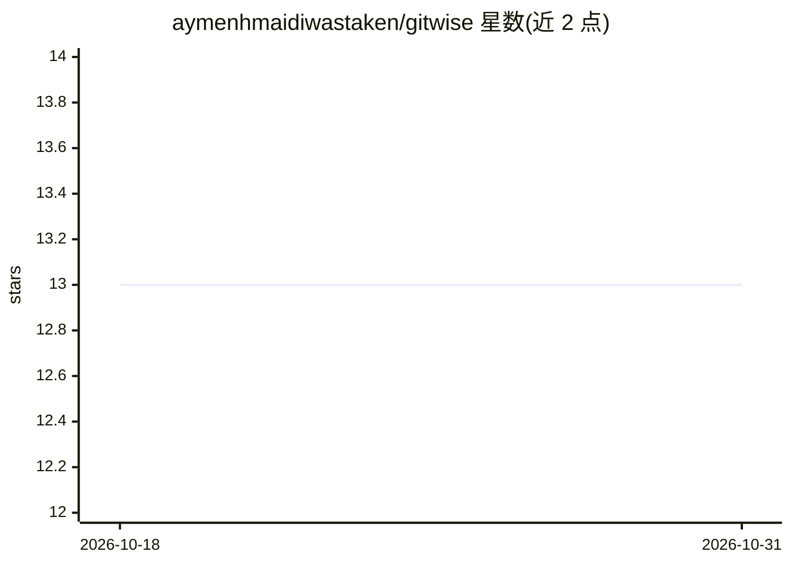

# aymenhmaidiwastaken/gitwise

⭐ 13 · Go · MIT · 推送 2026-03-16 · [GitHub](https://github.com/aymenhmaidiwastaken/gitwise) · 个人维护

**终端里的 AI 工具：生成 commit 信息、PR 描述与代码审查**

Go 编写的 Git 命令行工具，读取暂存 diff 后由 LLM 生成 conventional commit 信息、结构化 PR 描述、变更摘要与 CHANGELOG 条目，并可执行 AI 代码审查（逻辑错误、安全、性能）。默认接入本地 Ollama，也支持 OpenAI、Anthropic、Gemini 及任意 OpenAI 兼容端点（Groq、Together、LM Studio、vLLM）。附带 commit lint、git hook、多候选建议 TUI 选择、monorepo 分包与工单号自动关联；声明零遥测，本地模型时代码不出机器。

## 筛选速览

| 维度 | 判定 | 备注 |
|---|---|---|
| AI 角色 | `ai-native` | 本体是模型或模型工具 |
| 许可风险 | `permissive` | MIT |
| 部署形态 | `library` | 以包/库形式分发 |
| 模型依赖 | local-ok | 支持本地模型 |
| 硬件要求 | — | 无带数字的原话,不猜 |
| 安装摩擦 | `low` | 无编译、无系统依赖或容器化 |
| 成熟度 | — | 结构信号不足 |

## 能力要点

- 从暂存 diff 生成 conventional commit 与结构化 PR 描述
- AI 代码审查：逻辑/安全/性能/边界情况
- 默认 Ollama 本地运行，兼容 OpenAI/Anthropic/Gemini 及 OpenAI 兼容端点
- git hook 集成、commit lint、changelog 生成、多语言 commit

## 适用场景

- 我不想手写 commit 信息，让 AI 按 diff 生成并直接提交
- 提交前让 AI 审查代码中的 bug 与安全问题
- 在私有代码库上用本地 Ollama 生成 PR 描述

## 场景标签

`代码审查` · 领域:编码与开发

## 证据(README 行号)

> L27: gitwise commit        # AI generates a conventional commit message
> L28: gitwise review        # AI reviews your code for bugs before you commit
> L32: gitwise works with **Ollama** (local/private), **OpenAI**, **Anthropic**, **Google Gemini**, and any **OpenAI-compa

## 星数曲线

2026-10-18 13 → 2026-10-31 13（+0）

---
*卡片 v1 · prompt 1.4 · 生成 2026-10-31 · 置信度 high · 依据 README sha `62cae9ae5b67` · [字段定义](../../DATASET.md)*
