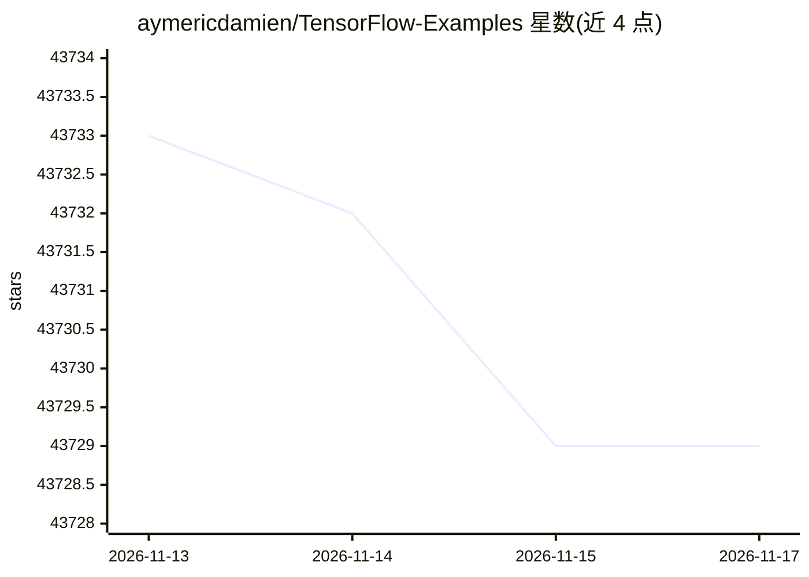

# aymericdamien/TensorFlow-Examples

⭐ 43,729 · Jupyter Notebook · NOASSERTION · 推送 2026-11-13 · [GitHub](https://github.com/aymericdamien/TensorFlow-Examples) · 个人维护

**面向初学者的 TensorFlow 教程与示例集合（TF v1 & v2）**

以 notebook 与带解释的源码形式提供 TensorFlow 入门教程，同时覆盖 TF v1 与 v2：从 Hello World、线性/逻辑回归等基础模型，到 CNN/RNN/LSTM、自编码器、GAN 等神经网络示例，另含模型保存、数据管道、图像增强、多 GPU 训练等工具章节，并链接 JAX 示例与 TFLearn 更多示例。MNIST 数据集在运行示例时自动下载；通过 git clone 获取示例、pip 安装 TensorFlow 运行。

## 筛选速览

| 维度 | 判定 | 备注 |
|---|---|---|
| AI 角色 | `ai-knowledge` | 知识聚合/清单类 |
| 许可风险 | `none` | NOASSERTION |
| 部署形态 | `library` | 以包/库形式分发 |
| 模型依赖 | — | README 未给出锁定关系 |
| 硬件要求 | — | 无带数字的原话,不猜 |
| 安装摩擦 | `low` | 无编译、无系统依赖或容器化 |
| 成熟度 | — | 结构信号不足 |

## 能力要点

- 同时覆盖 TF v1 与 v2，含 notebook 与带解释源码
- 涵盖基础模型、CNN/RNN/LSTM、AutoEncoder、GAN/DCGAN 等示例
- 含数据管道、TFRecords、图像增强、多 GPU 训练等工具章节
- MNIST 数据集运行时自动下载

## 适用场景

- 初学 TensorFlow 时按目录顺序学习从基础到神经网络的实现
- 查找 CNN、RNN、GAN 等模型的可运行参考代码
- 学习多 GPU 训练与数据管理管道写法

## 场景标签

`教程课程` · 领域:学习与行业

## 证据(README 行号)

> L3: This tutorial was designed for easily diving into TensorFlow, through examples. For readability, it includes both no
> L5: It is suitable for beginners who want to find clear and concise examples about TensorFlow. Besides the traditional '

## 星数曲线

2026-11-13 43,733 → 2026-11-17 43,729（-4）

---
*卡片 v1 · prompt 1.4 · 生成 2026-11-17 · 置信度 mid · 依据 README sha `b8917aa810ee` · [字段定义](../../DATASET.md)*
