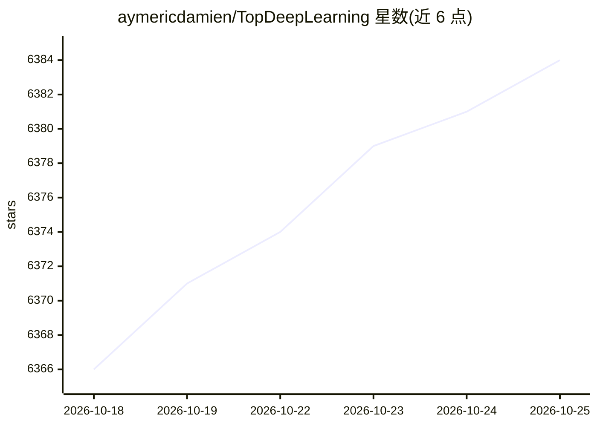

# aymericdamien/TopDeepLearning

⭐ 6,384 · Python · MIT · 推送 2026-07-15 · [GitHub](https://github.com/aymericdamien/TopDeepLearning) · 个人维护 · 中文 README

**按 star 排名的深度学习 GitHub 项目榜单清单**

由维护者定期更新的 GitHub 热门项目聚合清单：按 star 数排名收录 130 行级别的深度学习与 AI 相关开源项目，每条含项目名、star 数与一句话简介，覆盖框架（TensorFlow/PyTorch）、推理运行时（ollama/llama.cpp/vllm）、agent 工具、教程与中文社区项目等。本体是纯表格型策展清单，不提供代码或安装方式，仅供选型浏览与发现。

## 筛选速览

| 维度 | 判定 | 备注 |
|---|---|---|
| AI 角色 | `ai-knowledge` | 知识聚合/清单类 |
| 许可风险 | `permissive` | MIT |
| 部署形态 | `library` | 以包/库形式分发 |
| 模型依赖 | — | README 未给出锁定关系 |
| 硬件要求 | — | 无带数字的原话,不猜 |
| 安装摩擦 | `medium` | 含编译或系统依赖之一 |
| 成熟度 | — | 结构信号不足 |

## 能力要点

- 按 star 数排序的项目表格，每条含一句话简介
- 覆盖框架、推理运行时、agent 工具、教程等多类项目
- 标注最近更新日期（2026.07.14）

## 适用场景

- 浏览当前 star 数最高的深度学习开源项目
- 为技术选型收集候选项目线索
- 了解中文社区热门 AI 项目（JavaGuide/d2l-zh 等）

## 场景标签

`精选清单` · 领域:学习与行业

## 证据(README 行号)

> L1: # Top Deep Learning Projects
> L2: A list of popular github projects related to deep learning (ranked by stars).

## 星数曲线

2026-10-18 6,366 → 2026-10-25 6,384（+18）

---
*卡片 v1 · prompt 1.4 · 生成 2026-10-20 · 置信度 mid · 依据 README sha `c7625ffe1c3d` · [字段定义](../../DATASET.md)*
