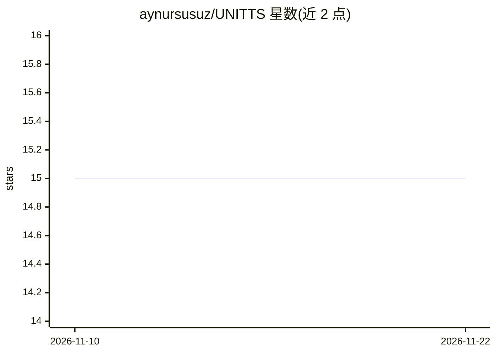

# aynursusuz/UNITTS

⭐ 15 · Python · Apache-2.0 · 推送 2026-11-09 · [GitHub](https://github.com/aynursusuz/UNITTS) · 个人维护

**统一 Python 接口封装 9 个开源 TTS 模型，换名即换引擎**

把本地与自托管的 9 个文本转语音模型（Chatterbox、MOSS-TTS、Higgs TTS 3、Fish Audio s2-pro、Qwen3-TTS、Echo-TTS、Kokoro、Supertonic、NeuTTS）聚合到同一 Python 接口与 CLI 之后：get_engine 按引擎名加载，unitts list-engines/synthesize/benchmark 提供命令行操作。每引擎在独立 Python 3.12 环境中经 scripts/setup.py 安装，setup 检查前置并报告缺失系统库；Higgs 走自托管 HTTP 服务。支持土耳其语等语言选择与多数引擎的语音克隆（参考音频）。附各引擎 RTF/VRAM 基准数据，README 声明这些测量非受控的速率或质量排名。各模型保留各自上游许可。

## 筛选速览

| 维度 | 判定 | 备注 |
|---|---|---|
| AI 角色 | `ai-ecosystem` | LLM/agent 周边工具 |
| 许可风险 | `permissive` | Apache-2.0 |
| 部署形态 | `None` |  |
| 模型依赖 | — | README 未给出锁定关系 |
| 硬件要求 | — | 无带数字的原话,不猜 |
| 安装摩擦 | `medium` | 含编译或系统依赖之一 |
| 成熟度 | — | 结构信号不足 |

## 能力要点

- 9 个 TTS 引擎共用同一 get_engine 接口与 CLI
- 一命令安装选定引擎到独立 Python 3.12 环境，setup 检查缺失系统库并给出修复指引
- 多数引擎支持语音克隆（ref_audio/ref_text），Higgs 自检测语言
- unitts benchmark 输出各引擎 JSON 结果与 WAV 音频样本

## 适用场景

- 在同一套代码里切换试用多个开源 TTS 模型，对比输出
- 为自己的应用接入多种 TTS 引擎而避免逐个适配
- 对候选 TTS 引擎跑基准与克隆/多语言冒烟测试

## 场景标签

`语音合成` · 领域:内容生成

## 证据(README 行号)

> L15: unitts gathers local and self-hosted text-to-speech models behind one Python interface. Call supported engines the 
> L37: engine = get_engine("moss-tts")  # use the engine installed above; names are in the table

## 星数曲线

2026-11-10 15 → 2026-11-22 15（+0）

---
*卡片 v1 · prompt 1.4 · 生成 2026-11-18 · 置信度 high · 依据 README sha `5ddd5cb6459c` · [字段定义](../../DATASET.md)*
