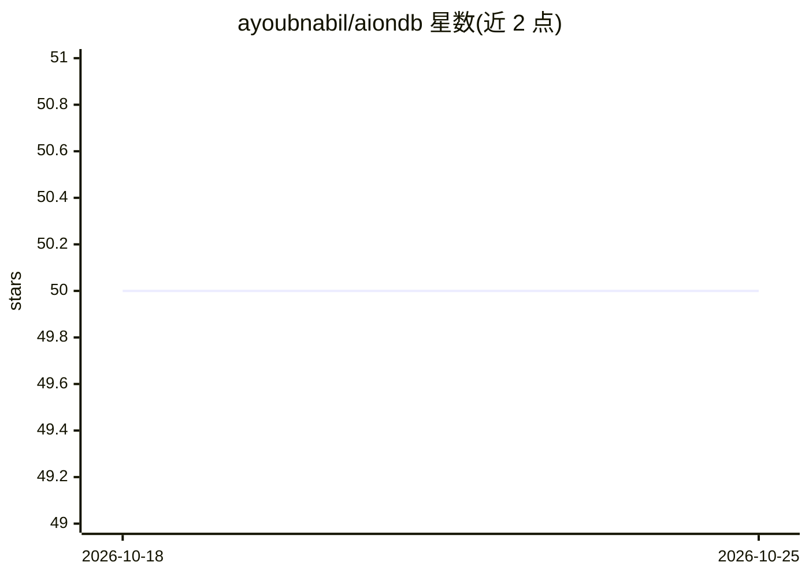

# ayoubnabil/aiondb

⭐ 50 · Rust · NOASSERTION · 推送 2026-07-23 · [GitHub](https://github.com/ayoubnabil/aiondb) · [官网](https://aiondb.xyz/) · 个人维护

**Rust 编写的 PostgreSQL 兼容 SQL/向量/图数据库**

用 Rust 从零实现的数据库，通过 PostgreSQL 线协议（pgwire）提供服务，psql 与常见驱动可直接连接。在统一 catalog 之上支持表、谓词、连接、事务与索引，VECTOR/HALFVEC 列类型与 pgvector 兼容类型转换，提供 HNSW 与 IVF-flat 索引（L2/余弦/内积/L1），以及普通表之上的节点/边标签图访问路径。附带 Docker Compose（服务器与 Studio UI）、init 引导设置、dump/restore 与可复现基准。v0.5 处于 Alpha 阶段，明确声明不适用于生产数据。

## 筛选速览

| 维度 | 判定 | 备注 |
|---|---|---|
| AI 角色 | `ai-ecosystem` | LLM/agent 周边工具 |
| 许可风险 | `none` | NOASSERTION |
| 部署形态 | `self-host` | docker 或自建部署 |
| 模型依赖 | — | README 未给出锁定关系 |
| 硬件要求 | — | 无带数字的原话,不猜 |
| 安装摩擦 | `low` | 无编译、无系统依赖或容器化 |
| 成熟度 | `idea` | |

## 能力要点

- PostgreSQL 线协议，psql 与常见驱动可直连
- VECTOR/HALFVEC 列与 pgvector 兼容类型转换，HNSW/IVF-flat 索引
- 同一 catalog 上的图访问路径（节点/边标签）
- Docker Compose 含服务器与 Studio，aiondb init 引导式初始化

## 适用场景

- 用现有 psql 与驱动直接接入，无需改客户端
- 构建图 RAG 等需要向量检索与图遍历一体化的应用
- 通过 Studio（http://127.0.0.1:8082）管理本地数据库实例

## 场景标签

`向量数据库` · 领域:知识与检索

## 证据(README 行号)

> L3: AionDB is a Rust database. It speaks the PostgreSQL wire protocol, stores
> L51: * HNSW and IVF-flat indexes. L2, cosine, inner product, L1.

## 星数曲线

2026-10-18 50 → 2026-10-25 50（+0）

---
*卡片 v1 · prompt 1.4 · 生成 2026-10-24 · 置信度 mid · 依据 README sha `3a132b9730a1` · [字段定义](../../DATASET.md)*
