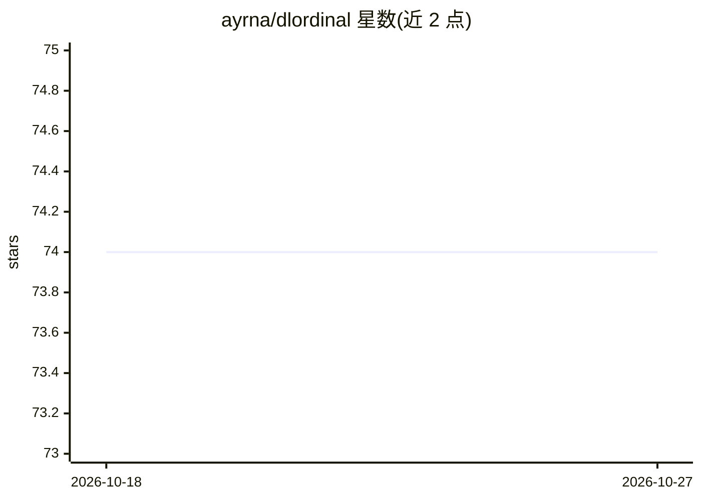

# ayrna/dlordinal

⭐ 74 · Python · BSD-3-Clause · 推送 2026-10-19 · [GitHub](https://github.com/ayrna/dlordinal) · 组织维护

**深度学习序数分类方法的 Python 工具库**

dlordinal 是基于 PyTorch 的 Python 库，汇集文献中的深度序数分类方法：提供序数损失函数、多种输出层、dropout 技术、软标签方法等分类策略，并包含考虑序数尺度上类别距离的评估指标；附带 FGNet 等序数基准数据集加载器，示例通过 skorch 训练 CNN。支持 Python 3.8–3.12，经 pip 安装，提供 tutorials 目录与 Sphinx 文档，有配套论文可引用。

## 筛选速览

| 维度 | 判定 | 备注 |
|---|---|---|
| AI 角色 | `ai-native` | 本体是模型或模型工具 |
| 许可风险 | `permissive` | BSD-3-Clause |
| 部署形态 | `library` | 以包/库形式分发 |
| 模型依赖 | — | README 未给出锁定关系 |
| 硬件要求 | — | 无带数字的原话,不猜 |
| 安装摩擦 | `low` | 无编译、无系统依赖或容器化 |
| 成熟度 | — | 结构信号不足 |

## 能力要点

- 汇集序数损失函数、输出层、dropout 与软标签等序数分类方法
- 包含考虑类别距离的序数评估指标
- 内置 FGNet 等序数基准数据集加载器
- 与 skorch/scikit-learn 生态配合训练 PyTorch 模型

## 适用场景

- 在年龄估计等有序类别任务中训练深度模型
- 对比和复现文献中的序数分类方法
- 用序数感知指标评估分类性能

## 场景标签

 · 领域:机器学习/分类工具

## 证据(README 行号)

> L3: `dlordinal` is a Python library that unifies many recent deep ordinal classification methodologies available in the 
> L41: ### Training a CNN model using the `skorch` library

## 星数曲线

2026-10-18 74 → 2026-10-27 74（+0）

---
*卡片 v1 · prompt 1.4 · 生成 2026-10-24 · 置信度 high · 依据 README sha `c21fcd4ef590` · [字段定义](../../DATASET.md)*
