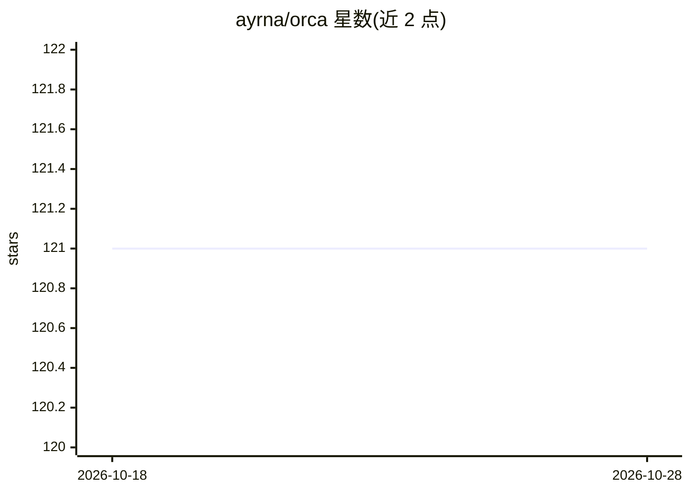

# ayrna/orca

⭐ 121 · C++ · GPL-3.0 · 推送 2026-10-08 · [GitHub](https://github.com/ayrna/orca) · [官网](http://www.uco.es/grupos/ayrna/orreview) · 组织维护

**序数回归/分类算法的 MATLAB 实验框架，供研究者对比方法**

由科尔多瓦大学 AYRNA 研究组维护的 MATLAB/Octave 工具箱，实现 SVORIM、SVOREX、POM、KDLOR、NNPOM、ELMOP 等约 20 种序数回归与分类算法，以及 MAE、CCR、Spearman、Kendall 等 10 种评估指标。通过配置文件或 API 描述实验，支持自动折执行、实验并行化（含 HTCondor）与性能报告，并整理 44 个公开序数数据集及文献所用分区以便利实验对比。用户可自行定义训练/测试方法与超参数加入新算法。发布页提供编译好的二进制文件。

## 筛选速览

| 维度 | 判定 | 备注 |
|---|---|---|
| AI 角色 | `ai-native` | 本体是模型或模型工具 |
| 许可风险 | `viral` | GPL-3.0 |
| 部署形态 | `desktop` | 安装包/桌面程序 |
| 模型依赖 | — | README 未给出锁定关系 |
| 硬件要求 | — | 无带数字的原话,不猜 |
| 安装摩擦 | `low` | 无编译、无系统依赖或容器化 |
| 成熟度 | — | 结构信号不足 |

## 能力要点

- 实现约 20 种序数回归/分类算法（SVM、神经网络、ELM、集成等）与 10 种评估指标
- 配置文件描述实验，支持自动折执行、并行化与 HTCondor
- 整理 44 个公开序数数据集及文献使用的分区
- 支持以自定义训练/测试方法与超参数接入新算法

## 适用场景

- 我想在多个序数回归算法与数据集之间做系统性实验对比
- 我想复现序数回归综述论文中的实验结果
- 我想把自己的新算法接入统一框架进行评估

## 场景标签

`科研工具` · 领域:学习与行业

## 证据(README 行号)

> L9: ORCA (Ordinal Regression and Classification Algorithms) is a MATLAB framework that implements and integrates a wide 
> L68:  - SVR [2]: Standard Support Vector Regression with normalised targets (considered as a naïve approach for ordinal 

## 星数曲线

2026-10-18 121 → 2026-10-28 121（+0）

---
*卡片 v1 · prompt 1.4 · 生成 2026-10-23 · 置信度 mid · 依据 README sha `981d0d5c5b30` · [字段定义](../../DATASET.md)*
